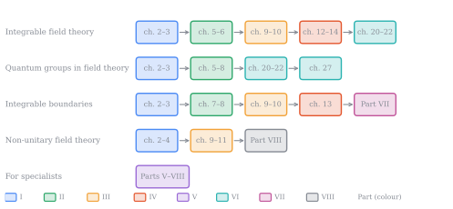

# Introduction and reader's guide {#sec-introduction}

Affine Toda field theories are a family of two-dimensional quantum field theories, one for each affine Kac–Moody algebra $\hat g$. They are integrable, so many of their properties can be computed exactly, and they are rich enough to display most of the phenomena of interacting quantum field theory: particles and bound states, solitons and breathers, strong–weak duality, quantum-group symmetry, integrable boundaries and, at imaginary coupling, non-unitarity. This book introduces them to a reader who knows quantum field theory but has not met affine Toda theory, Kac–Moody algebras or quantum groups, and leads that reader to current research.

## About this book {#sec-about}

**Authorship.** This book has been created by a collection of researchers who have worked on Toda field theory, including Gustav Delius, Niall MacKay,  Gerard Watts, .... 
**Most of the text and the supporting code, was written by Claude, an AI model made by Anthropic**, working from outlines, source papers and briefs supplied by the authors, and checked in repeated review passes by the authors and by further Claude instances acting as referees. The mathematics and physics were directed and are the responsibility of the authors, but a reader should know that the prose, many of the proofs and the numerical checks are machine-drafted. Errors may remain in all of them. Where a result matters to you, check the proof, and where the book gives a script (`textbook_code/`, `foundations_code/`, `soliton_rmatrix_code/`; see the [guide to the supporting code](appendices/C-code.qmd)), run it.

**Prerequisites.** Quantum field theory at the level of a first graduate course (path integrals, perturbation theory, renormalization, the S-matrix), finite-dimensional Lie algebras at the level of $su(n)$, and complex analysis. Everything else is developed in the text.

**Status.** All chapters are drafted. Parts I–IV, Part VII and the textbook chapters of Parts V–VI have not yet been refereed by a human specialist. The record of what has been checked, and how, is in the repository (`briefs/referee_textbook.md`, for Part VII `briefs/referee_half_line_*.md`, and `textbook_code/`).

::: {.content-visible when-format="html"}
The whole book is also available as a [PDF](affine-toda.pdf).
:::

## Presentation and new results {#sec-new-results}

Parts I–IV, Part VII on the half-line, and the introductory chapters of Parts V and VI present established material. We have rewritten it in a common notation and with consistent conventions, and have added exercises, figures and some derivations that the original papers omit, but the results are those of the literature cited in each chapter's *Notes and references*. Parts V, VI and VIII contain original results, and re-deriving Part VII in one set of conventions produced some corrections and identifications that are new. We list them here so that a reader can tell what is new. From Part V on, the main statements carry a status label:

- **[Theorem]**, with a complete proof given here;
- **[Proposition, sketch]**, with a proof outline that a specialist could complete;
- **[Established]**, proved or computed in the cited literature (**[Established; reformulated]** when we restate it in a different form);
- **[Numerical]**, checked numerically by a script in the repository but not proved;
- **[Conjecture]**, with the supporting evidence stated.

**Original results.**

- **A selection rule from the antilinear symmetry $\Theta$** (chapter 11, with the Krein structure of Part VIII). Reality of soliton energies and charges was shown for specific solution classes by Olive, Turok and Underwood, Zhu and Caldi, and Freeman, and complex-energy and singular solutions were found by Khastgir and Sasaki and by Takács and Watts. The new point is that all of these follow from one criterion: classical energies and charges are real precisely when the asymptotic data are invariant under the $PT$-type symmetry $\Theta$. The earlier restriction to "good" solutions becomes a symmetry statement. The same $\Theta$, together with an indefinite (Krein) inner product, is the foundation of the quantum theory of Part VIII.
- **Semiclassical quantization of complex solitons** (chapters 17–19). The application of Picard–Lefschetz theory to the saddles of affine Toda theory; the counting rule that eigenvalues of the non-Hermitian fluctuation operator be counted with algebraic multiplicity, which resolves the disagreements between earlier one-loop computations for $c_n^{(1)}$ and $b_n^{(1)}$; its derivation from the transmission factors, with Jordan blocks that have the sizes of the zeros, and a transmission-factor formula for one-loop masses that extends the Cahill–Comtet–Glauber formula to several channels, to poles and to complex solitons; one-loop masses of all folded solitons; and a prediction of the $f_4^{(1)}$ soliton masses. The Hirota form of the fluctuation operator for $d_n^{(1)}$, $e_n^{(1)}$ and their foldings is established for rank at most 8 and assumed beyond. The reduction to Pöschl–Teller wells uses known heat-trace results for single real channels, which we cite.
- **New soliton S-matrices** (chapters 23–25). Constructions for the spinor solitons of $c_n^{(1)}$ ($n\ge3$) and $a_{2n-1}^{(2)}$ ($n\ge3$), and for $e_6^{(2)}$, from the known R-matrices, with checks against one-loop and lattice masses. These three families were previously missing, contrary to a common impression that all soliton S-matrices were known.
- **The $f_4^{(1)}$ obstruction** (chapter 26). A candidate amplitude satisfying all the axioms, shown by a one-loop computation not to be the right one. The soliton S-matrix of $f_4^{(1)}$ remains open.
- **Unitary RSOS subtheories** (chapter 27). An exact criterion for when the kinks of the restricted $a_2^{(1)}$ theory, the perturbed $W_3(p,p')$ models, have a Hermitian-analytic and unitary S-matrix, and a conjectured general criterion.
- **Corrections and identifications on the half-line** (chapters 28–35). Part VII is textbook material, but checking every key formula by script changed some of it. The Neumann boundary of $a_n^{(1)}$ has the non-diagonal soliton reflection matrix with sign $s=+1$, and the diagonal one belongs to the uniform boundary $C_j\equiv+1$, contrary to the assignment of Delius and MacKay; we state this as a conjecture, with the evidence. The allowed boundary parameters of the quantum symmetry are $\hat\epsilon_j^2=1/\big((1-q)(1-q^{-1})\big)$, a value first given by Baseilhac and Belliard. We explain it by a Serre-type relation of the boundary coideal, and show that these coideals are not quantum symmetric pairs in Kolb's sense, but images of one under a character twist. Misprints in several of the source papers are corrected in the chapter notes, and @sec-app-corrections collects all the corrections to the literature that the book makes.
- **The foundations of the non-unitary theory** (chapters 36–41). A lattice regularization of every imaginary-coupling theory whose partition function is a convergent sum of positive Coulomb-gas weights, so that the complex action gives no sign problem; the Krein-space transfer matrix with its antilinear symmetry $\Theta$; reality of the finite-volume vacuum energy; a finite-volume continuum limit for every algebra below the first collapse threshold $\beta^2_{\rm UV}$ (awaiting independent check); a Krein-unitarity criterion for the eigenvalues of S-matrices, with the proof that it holds for the fundamental solitons of $a_n^{(1)}$; the graded exchange statistics of solitons as a Bloch twist; and a list of the consequences of unitarity that cannot be restored.

**Presentation of known material.** The book also gathers, in one notation, results that the literature scatters: factorized scattering and sine-Gordon (Part I), root systems, affine algebras, quantum groups and R-matrices (Part II), classical solitons and Hirota solutions (Part III), the exact particle S-matrices, the thermodynamic Bethe ansatz and form factors at real coupling (Part IV), the quantum-group symmetry and bootstrap construction of soliton S-matrices (chapters 20–22), and the theory on the half-line: integrable boundary conditions, solitons reflected by the boundary, the boundary quantum-group symmetry and the reflection matrices it determines, and their place in the theory of quantum symmetric pairs (Part VII).

Statements labelled **[Theorem]** have complete proofs in the text but, being new, have not been checked by anyone outside the project. The Part VIII continuum-limit theorems in particular await independent checking.

## Why affine Toda theory matters {#sec-why-atft-matters}

For each affine Kac–Moody algebra $\hat g$ there is a Lagrangian field theory of $r=\operatorname{rank}g$ scalars with exponential interactions, the affine Toda field theory. Its Lagrangian is $\mathcal L=\tfrac12\partial_\mu\vec\phi\cdot\partial^\mu\vec\phi-V(\vec\phi)$, with $\vec\phi\in\mathbb R^r$ and one of the two potentials

$$
V_{\rm real}=\frac{m^2}{\beta^2}\sum_jn_j\left(e^{\beta\vec\alpha_j\cdot\vec\phi}-1\right),\qquad
V_{\rm imag}=-\frac{m^2}{\beta^2}\sum_jn_j\left(e^{i\beta\vec\alpha_j\cdot\vec\phi}-1\right).
$$

The sums run over the $r+1$ simple roots $\vec\alpha_0,\dots,\vec\alpha_r\in\mathbb R^r$ of $\hat g$, the $n_j$ are positive integers called Kac labels, $m$ sets the mass scale and $\beta>0$ is the coupling. Part II defines the roots and labels (@sec-affine-dynkin), and Part III takes up the theory again from these potentials (-@eq-imaginary-potential). Until then two facts suffice. The labels satisfy $\sum_jn_j\vec\alpha_j=0$, so $\vec\phi=0$ is a stationary point of both potentials. For the smallest algebra, $a_1^{(1)}$, one has $r=1$, $\alpha_1=-\alpha_0=\sqrt2$ and $n_0=n_1=1$, and the two potentials are those of sinh-Gordon and sine-Gordon theory (@sec-sg-dictionary).

These theories have been a laboratory for several central ideas in two-dimensional quantum field theory:

- exact factorized S-matrices and the bootstrap [@zz1979; @braden1990];
- the geometry of root systems in scattering (Dorey's fusing rule [@dorey1991]);
- strong–weak coupling duality [@braden1990; @dgz1992];
- solitons with quantum-group symmetry [@bernard1991; @hollowood1993b];
- integrable boundary conditions and reflection matrices [@gz1994; @bcdr1995; @delius_mackay2003];
- integrable perturbations of conformal field theories [@zamolodchikov1989; @eguchi1989; @hollowood1989];
- the ODE/IM correspondence [@lukyanov2010; @dorey2013].

The theories come in two regimes.

- **Real coupling.** The theory is an ordinary unitary QFT with a unique vacuum and $r$ massive particles.
- **Imaginary coupling.** The potential is periodic and complex. There are infinitely many degenerate vacua, solitons interpolating between them, and breathers. These are the theories that describe perturbed (W-algebra) minimal models after quantum-group restriction, and they carry the richest physics.

@fig-two-regimes shows the two kinds of potential for $a_1^{(1)}$ and $a_2^{(1)}$.

{#fig-two-regimes fig-alt="Left: the cosh potential with one minimum and the cosine potential with infinitely many minima, with an arrow for a kink between adjacent minima. Right: a contour plot of the real part of the imaginary-coupling potential of a_2^(1) over the plane of the two fields, with its minima at the points of a triangular lattice."}

The theories are not only of historical interest. They are rich enough to show generic phenomena of quantum field theory, yet solvable enough that claims about them can be checked exactly. Five features keep them current.

- **A family, not a single model.** There is one theory for each affine algebra, and results come with Lie-theoretic structure: Dorey's fusing rule, Perron–Frobenius masses, Lie duality. A general claim about integrable or massive two-dimensional QFT can therefore be tested across a whole family, not in one example.
- **Exact benchmarks.** At real coupling the S-matrices are known for every algebra, together with the thermodynamic Bethe ansatz, form factors and the exact mass–coupling relation (@sec-real-coupling). New methods are calibrated against them. Recent examples are tree-level integrability for every ATFT, derived from properties of root systems [@dorey_polvara2022], one-loop integrability of the simply-laced theories [@polvara2023], and the comparison of one-loop amplitudes with the bootstrap S-matrices for the whole simply-laced class [@fabri_polvara2024].
- **A non-unitary QFT with structure.** The imaginary-coupling theories are the field-theoretic parents of non-unitary perturbed minimal and W-algebra models. We argue that their non-unitarity is organised by a Krein structure and an antilinear $PT$-type symmetry $\Theta$, and is not a pathology. That is the question non-Hermitian physics now asks of many systems (@sec-connections-current-research).
- **Unfinished business.** The soliton S-matrix of $f_4^{(1)}$ is still missing, and those of $c_n^{(1)}$, $a_{2n-1}^{(2)}$ and $e_6^{(2)}$ are constructed in Part VI, though not for every soliton species (@sec-imaginary-coupling-quantum-theory). The disagreements over one-loop soliton masses needed a new counting rule to resolve (@sec-semiclassics). The missing-topological-charge problem is open, and static complex saddles cannot resolve it (@sec-which-saddles-contribute). On the half-line, particle reflection amplitudes are known only for $a_n^{(1)}$, and those of the Neumann boundary have been derived from the solitons only for $a_2^{(1)}$ (@sec-boundary-open-problems). Open problems in a theory whose surroundings are this well mapped are unusually well posed.
- **A meeting point of mathematics and physics.** Quantum affine algebras and their R-matrices, quantum symmetric pairs and their K-matrices, Hirota tau-functions, Coulomb gases and Picard–Lefschetz theory all act on the same model. Progress in any one of them tends to have consequences here.

## How this book is organised {#sec-reader-guide}

The book has eight parts.

- **Part I** collects the physical background: factorized scattering in two dimensions, sine-Gordon theory as the rank-one template, and the non-Hermitian quantum mechanics needed for the imaginary-coupling theories.
- **Part II** collects the algebraic background: root systems, affine Kac–Moody algebras, quantum groups and R-matrices.
- **Part III** treats the classical field theory: Lagrangians, integrability, solitons and the reality of their energies.
- **Part IV** treats the quantum theory at real coupling, where the exact particle S-matrices are known for every algebra.
- **Part V** treats the semiclassical quantization of the complex solitons of the imaginary-coupling theories.
- **Part VI** treats their exact soliton S-matrices, including the constructions for $c_n^{(1)}$, $a_{2n-1}^{(2)}$ and $e_6^{(2)}$ and the open case $f_4^{(1)}$.
- **Part VII** restricts the theories to a half-line: integrable boundary conditions, solitons and their mirror images, the remnant of quantum-group symmetry that a boundary leaves unbroken and its place in the theory of quantum symmetric pairs, and the exact reflection amplitudes of solitons and particles.
- **Part VIII** asks whether the imaginary-coupling theories exist as quantum field theories, and answers: yes, as non-unitary ones.

Parts I–IV are textbook material. Parts V, VI and VIII present research results, many of them new. Part VII presents the theory on the half-line, developed in the research literature since 1993, in textbook form.

The dependencies between the parts are shown below. Chapter 4 is needed only for Parts V and VIII, and Part II is needed in full only for Parts VI and VII.

```{mermaid}
%%| label: fig-dependencies
%%| fig-cap: "Dependencies between the parts of the book. An arrow means that the later part uses the earlier one. Chapter 4 of Part I, on non-Hermitian quantum mechanics, is drawn separately because only Parts V and VIII use it."
%%| fig-width: 6
flowchart LR
  I["I. Physical background<br/>ch. 2–3"] --> III["III. Classical theory<br/>ch. 9–11"]
  II["II. Algebraic background<br/>ch. 5–8"] --> III
  I --> IV["IV. Real coupling<br/>ch. 12–15"]
  III --> IV
  III --> V["V. Semiclassics<br/>ch. 16–19"]
  IV --> VI["VI. Soliton S-matrices<br/>ch. 20–27"]
  II --> VI
  V --> VI
  VI --> VII["VII. Half-line<br/>ch. 28–35"]
  III --> VII
  IV --> VII
  V --> VIII["VIII. Foundations<br/>ch. 36–41"]
  I4["I. Non-Hermitian QM<br/>ch. 4"] --> V
  I4 --> VIII
  VI --> VIII
```

**Reading paths.**

- *A course on integrable field theory:* chapters 2–3, 5–6, 9–10, 12–14, then 20–22. This covers sine-Gordon, the classical theory, the particle S-matrices and the known soliton S-matrices.
- *A course on quantum groups in field theory:* chapters 2–3 and 5–8, then 20–22 and 27.
- *Integrable boundaries:* chapters 2–3, 7–10 and 13, then Part VII, consulting chapters 20–21 for the quantum-group method.
- *Non-unitary quantum field theory:* chapters 2–4, 9–11, then Part VIII, consulting Parts V–VI as needed.
- *For specialists:* Parts V–VIII, which can be read on their own by a reader who already knows affine Toda theory.

The five paths are drawn in @fig-reading-paths.

{#fig-reading-paths fig-alt="Five rows of boxes joined by arrows. The first row runs through chapters 2 to 3, 5 to 6, 9 to 10, 12 to 14 and 20 to 22. The second runs through chapters 2 to 3, 5 to 8, 20 to 22 and 27. The third runs through chapters 2 to 3, 7 to 8, 9 to 10, 13 and Part VII. The fourth runs through chapters 2 to 4, 9 to 11 and Part VIII. The fifth is a single box for Parts V to VIII."}

**What Part I borrows from Part II.** Part I uses some algebraic terms before Part II defines them. They appear in statements about general affine Toda theories, which a first reading can take on trust, and the sine-Gordon case of @sec-sine-gordon needs none of them in more than its simplest form. In brief:

- **Affine Kac–Moody algebra** $\hat g=X_n^{(k)}$: an infinite-dimensional extension of a simple Lie algebra, untwisted for $k=1$ and twisted for $k=2,3$. All the theory needs from it is its simple roots $\vec\alpha_j$, its Kac labels $n_j$ and its **affine Dynkin diagram**, a graph with one node per simple root (@sec-affine-algebras).
- **Cartan matrix, Coxeter number $h$, exponents**: the Cartan matrix is the matrix $a_{ij}=2\vec\alpha_i\cdot\vec\alpha_j/\vec\alpha_i^2$ of the simple roots; the Coxeter number is $h=\sum_jn_j$; and the exponents are a set of positive integers attached to each algebra (for untwisted $\hat g=g^{(1)}$, $r$ integers between 1 and $h-1$), which become the spins of the conserved charges (@sec-roots, @sec-weyl-coxeter, @sec-conserved-charges).
- **Perron–Frobenius eigenvector**: the eigenvector of the Cartan matrix of $g$ with positive components; in the simply-laced theories the particle masses are proportional to its components (@sec-perron-frobenius).
- **Dorey's fusing rule**: a criterion, in terms of the Coxeter element of the Weyl group, for which three-point couplings of particles are nonzero (@sec-dorey-rule).
- **Duality of algebras and Lie duality**: reversing the arrows of an affine Dynkin diagram gives the dual algebra $\hat g^\vee$; "Lie duality" relates the soliton masses of $g^{(1)}$ to the particle masses of $(g^\vee)^{(1)}$ (@sec-affine-folding).
- **Quantum affine algebras** $U_q(\hat g)$: deformations of the symmetry algebra of $\hat g$. They are Hopf algebras, whose coproduct says how a symmetry acts on multi-particle states and whose antipode gives crossing. Their **evaluation representations** are finite-dimensional representations depending on a spectral parameter, which becomes the rapidity (@sec-quantum-groups).
- **IRF (RSOS) basis and quantum-group restriction**: a change of basis from soliton labels to sequences of vacua, after which, when $q$ is a root of unity, all but finitely many vacua can be discarded consistently (@sec-irf, @sec-qg-restriction). The restricted theories are perturbed minimal models of Virasoro or of $W$-algebras, the conformal field theories with higher-spin symmetry currents (@sec-perturbed-minimal).

## Conventions {#sec-conventions}

We use units with $\hbar=c=1$ and the metric signature $(+,-)$. Rapidities are written $\theta$, and two-particle amplitudes depend on the rapidity difference (@sec-rapidities).

Roots are normalized so that the longest roots of the finite algebra have squared length 2, as in @sec-lie-algebraic-data. Some of the literature instead gives the longest root of a twisted algebra $X_n^{(k)}$ squared length $2k$; its coupling is then $\beta_{\rm lit}^2=\beta^2/k$, and we convert whenever we quote such results. The coupling $\beta$ is always real and positive. "Real coupling" and "imaginary coupling" refer to the two potentials $V_{\rm real}$ and $V_{\rm imag}$ of @sec-why-atft-matters, restated as (-@eq-imaginary-potential), not to the sign of $\beta^2$. For $a_1^{(1)}$ our $\beta$ is related to the conventional sine-Gordon coupling by $\beta_{\rm SG}^2=2\beta^2$ (@sec-sine-gordon).

In Part VII the field lives on the half-line $x\le0$, with the boundary at $x=0$. A boundary potential, with one coefficient $C_j$ for each simple root, fixes the boundary condition (@sec-boundary-potential).
