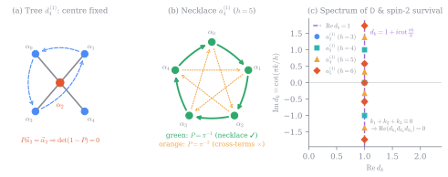
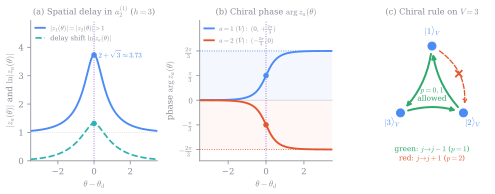

# The Necklace Selection Rule, the Defect Lax Matrix, and Chiral Solitons {#sec-lec3-necklace-lax}

> **Companion reading in the book:** the chapters [Classically integrable defects](book:sec-defect-conditions) and [Solitons and particles through a defect](book:sec-defect-solitons).

In Lecture 2 (@sec-lec2-momentum-backlund), we discovered a remarkable phenomenon for a single scalar field: requiring **spin-1 momentum conservation alone** across a defect forces the defect sewing conditions to become a Bäcklund transformation and restricts the bulk potential to the integrable sine-Gordon/sinh-Gordon, Liouville, or free-field families.

Now comes the obvious question every student should ask: *what happens when the bulk field $\vec{\phi}(x,t) \in \mathbb{R}^r$ has $r > 1$ components, as in a general affine Toda field theory (ATFT) associated with an affine Kac–Moody algebra $\hat{\mathfrak{g}}$?*

Recall from Part I of the book that *every* affine Dynkin diagram—$a_r^{(1)}$, $b_r^{(1)}$, $c_r^{(1)}$, $d_r^{(1)}$, the exceptional series $e_{6,7,8}^{(1)}, f_4^{(1)}, g_2^{(1)}$, and all the twisted algebras—gives a classically integrable bulk ATFT with a Lax pair and infinitely many conserved higher-spin charges. If you put a boundary at $x=0$, several of these families also admit integrable boundary conditions.

So you might naturally guess that *every* affine Toda theory admits an integrable momentum-conserving jump defect.

**That guess is false.** When Bowcock, Corrigan, and Zambon [@bcz2004; @bcz2004b] generalized our spin-1 momentum-conservation calculation to an $r$-component field, they discovered a stunning selection rule: **only the $a_r^{(1)}$ necklace of roots** admits a non-trivial momentum-conserving type-I defect! Every other root system fails at the very first step—spin-1 momentum conservation.

In this lecture, we will do three crucial calculations on the blackboard:

1. **The Multi-Component Momentum Calculation and the Necklace Selection Rule:** We will write the general multi-component defect action, compute the time derivative of total momentum $\frac{d}{dt}(P + P_d)$, and watch how the cancellation of velocity-quadratic, velocity-linear, and velocity-independent terms forces the defect coupling matrix $\mathsf{D}$ to take the universal form
   $$
   \mathsf{D} = 2(1 - P)^{-1},
   $$
   where $P$ is a single-cycle automorphism of the extended Dynkin diagram satisfying $\vec{\alpha}_i \cdot \mathsf{D}\vec{\alpha}_j = 2\delta_{ij} - 2\delta_{i,j+1}$. Only the $a_r^{(1)}$ necklace possesses such a cyclic clock shift!
2. **Overlapping Lax Pairs, the Defect Monodromy Matrix $L_d(\lambda)$, and the Survival of All Higher Spins:** We will derive the defect Lax matrix $L_d(\lambda)$ by overlapping two bulk Lax pairs across $x=0$, verify that its Poisson bracket with itself is governed by the bulk classical $r$-matrix, and do the beautiful Fourier-mode calculation on the blackboard showing why the cubic spin-2 defect obstruction vanishes via a classic trigonometric identity for the $a_r^{(1)}$ eigenvalues $d_k = 1 + i\cot\frac{\pi k}{h}$.
3. **Solitons in $a_r^{(1)}$ (Worked Out in Full for $a_2^{(1)}$):** Using the Hirota $\tau$-function method, we will derive the complex transmission factor $z_a(\theta)$ for a species-$a$ soliton, discover the **chiral topological charge selection rule** (why a defect can change a soliton's topological charge along the clock direction of the necklace, but never against it!), and see how a pair of conjugate defects traps a **frozen static soliton**.

---

## Multi-Component Momentum Conservation and Why Only $a_r^{(1)}$ Works {#sec-lec3-momentum-necklace}

Let us set up the multi-component laboratory. On the left half-line $x < 0$ lives an $r$-component field $\vec{\phi}(x,t) \in \mathbb{R}^r$, and on the right half-line $x > 0$ lives $\vec{\psi}(x,t) \in \mathbb{R}^r$, both governed by the same bulk ATFT potential
$$
V(\vec{\phi}) = \frac{m^2}{b^2} \sum_{j=0}^r n_j \left(e^{b\vec{\alpha}_j \cdot \vec{\phi}} - 1\right), \qquad \sum_{j=0}^r n_j \vec{\alpha}_j = \vec{0},
$$ {#eq-lec3-bulk-potential}
where $\vec{\alpha}_1, \dots, \vec{\alpha}_r$ are the simple roots, $\vec{\alpha}_0 = -\sum_{i=1}^r n_i \vec{\alpha}_i$ is the lowest root, $n_0 = 1$, and $h = \sum_{j=0}^r n_j$ is the Coxeter number.

### The General Multi-Component Defect Action

What is the most general first-order defect Lagrangian we can write at $x=0$? In Lecture 2, for $r=1$, any self-couplings $\phi\dot{\phi}$ or $\psi\dot{\psi}$ were pure total time derivatives $\frac{d}{dt}(\frac{1}{2}\phi^2)$ and dropped out of the equations of motion. For $r > 1$, however, we can contract $\vec{\phi}$ with $\dot{\vec{\phi}}$ using a non-Zero **antisymmetric** $r \times r$ matrix $E^{\mathsf{T}} = -E$! Indeed,
$$
\frac{d}{dt}\left(\frac{1}{2}\vec{\phi}\cdot E\vec{\phi}\right) = \frac{1}{2}\dot{\vec{\phi}}\cdot E\vec{\phi} + \frac{1}{2}\vec{\phi}\cdot E\dot{\vec{\phi}} = \frac{1}{2}\vec{\phi}\cdot(E^{\mathsf{T}} + E)\dot{\vec{\phi}} = 0,
$$
so $\frac{1}{2}\vec{\phi}\cdot E\dot{\vec{\phi}}$ is *not* a total time derivative when $E^{\mathsf{T}} = -E$: its Euler–Lagrange variation gives $E\dot{\vec{\phi}}$.

Thus, the general type-I defect action is (see [the book](book:eq-defect-action)):
$$
S[\vec{\phi},\vec{\psi}] = \int_{-\infty}^0 dx \int dt\, \mathcal{L}_{\text{bulk}}(\vec{\phi}) + \int_0^\infty dx \int dt\, \mathcal{L}_{\text{bulk}}(\vec{\psi}) + \int dt \left[\frac{1}{2}\vec{\phi}\cdot E\dot{\vec{\phi}} + \vec{\phi}\cdot \mathsf{D}\dot{\vec{\psi}} + \frac{1}{2}\vec{\psi}\cdot F\dot{\vec{\psi}} - \mathcal{B}_d(\vec{\phi},\vec{\psi})\right]_{x=0},
$$ {#eq-lec3-action}
where $E$ and $F$ are real antisymmetric $r\times r$ matrices ($E^{\mathsf{T}} = -E$, $F^{\mathsf{T}} = -F$) and $\mathsf{D}$ is a real invertible $r\times r$ coupling matrix.

Varying $S[\vec{\phi},\vec{\psi}]$ with respect to $\delta\vec{\phi}(0,t)$ and $\delta\vec{\psi}(0,t)$ (remembering to integrate $\vec{\phi}\cdot \mathsf{D}\delta\dot{\vec{\psi}}$ by parts in time, which flips its sign!) yields the multi-component defect sewing conditions at $x=0$ (see [the book](book:eq-defect-conditions)):
$$
\begin{aligned}
\partial_x \vec{\phi} &= E\,\partial_t\vec{\phi} + \mathsf{D}\,\partial_t\vec{\psi} - \nabla_{\vec{\phi}}\mathcal{B}_d(\vec{\phi},\vec{\psi}), \\
\partial_x \vec{\psi} &= \mathsf{D}^{\mathsf{T}}\,\partial_t\vec{\phi} - F\,\partial_t\vec{\psi} + \nabla_{\vec{\psi}}\mathcal{B}_d(\vec{\phi},\vec{\psi}).
\end{aligned}
$$ {#eq-lec3-defect-conditions}
Notice the minus sign in front of $F\partial_t\vec{\psi}$: it comes from the right-hand bulk boundary term $+\int dt\,\partial_x\vec{\psi}\cdot\delta\vec{\psi}|_{x=0^+}$ and the variation of the defect kinetic term.

Just as in Lecture 2, the total energy $E_{\text{tot}} = E_{\text{left}} + E_{\text{right}} + \mathcal{B}_d(\vec{\phi}(0,t),\vec{\psi}(0,t))$ is conserved *automatically* for any $E, F, \mathsf{D}, \mathcal{B}_d$ because the antisymmetry $E^{\mathsf{T}} = -E$ and $F^{\mathsf{T}} = -F$ makes $\dot{\vec{\phi}}\cdot E\dot{\vec{\phi}} = 0$ and $\dot{\vec{\psi}}\cdot F\dot{\vec{\psi}} = 0$, while the cross-terms $\dot{\vec{\phi}}\cdot\mathsf{D}\dot{\vec{\psi}}$ cancel between the two sides.

### Blackboard Calculation: Imposing Spin-1 Momentum Conservation

Now let us impose spin-1 momentum conservation. The bulk field momentum is
$$
P = -\int_{-\infty}^0 dx\,\partial_t\vec{\phi}\cdot\partial_x\vec{\phi} - \int_0^\infty dx\,\partial_t\vec{\psi}\cdot\partial_x\vec{\psi}.
$$
Taking its time derivative and using the bulk equation of motion $\partial_t^2\vec{\phi} - \partial_x^2\vec{\phi} = -\nabla_{\vec{\phi}}V(\vec{\phi})$ gives the momentum flux jump at $x=0$:
$$
\frac{dP}{dt} = \left[-\frac{1}{2}|\partial_t\vec{\phi}|^2 - \frac{1}{2}|\partial_x\vec{\phi}|^2 + V(\vec{\phi}) + \frac{1}{2}|\partial_t\vec{\psi}|^2 + \frac{1}{2}|\partial_x\vec{\psi}|^2 - V(\vec{\psi})\right]_{x=0}.
$$ {#eq-lec3-dp-dt}
We demand that there exist a defect momentum function $P_d(\vec{\phi},\vec{\psi})$ such that
$$
\frac{dP}{dt} = -\frac{d}{dt}P_d\big(\vec{\phi}(0,t),\vec{\psi}(0,t)\big) = -\partial_t\vec{\phi}\cdot\nabla_{\vec{\phi}}P_d - \partial_t\vec{\psi}\cdot\nabla_{\vec{\psi}}P_d
$$ {#eq-lec3-momentum-balance}
holds identically whenever $\partial_x\vec{\phi}$ and $\partial_x\vec{\psi}$ are eliminated via the defect conditions (-@eq-lec3-defect-conditions).

Let us substitute (-@eq-lec3-defect-conditions) into $|\partial_x\vec{\phi}|^2 - |\partial_x\vec{\psi}|^2$ and expand in powers of the velocities $\partial_t\vec{\phi}$ and $\partial_t\vec{\psi}$:
$$
\begin{aligned}
|\partial_x\vec{\phi}|^2 &= |E\dot{\vec{\phi}} + \mathsf{D}\dot{\vec{\psi}}|^2 - 2(E\dot{\vec{\phi}} + \mathsf{D}\dot{\vec{\psi}})\cdot\nabla_{\vec{\phi}}\mathcal{B}_d + |\nabla_{\vec{\phi}}\mathcal{B}_d|^2, \\
|\partial_x\vec{\psi}|^2 &= |\mathsf{D}^{\mathsf{T}}\dot{\vec{\phi}} - F\dot{\vec{\psi}}|^2 + 2(\mathsf{D}^{\mathsf{T}}\dot{\vec{\phi}} - F\dot{\vec{\psi}})\cdot\nabla_{\vec{\psi}}\mathcal{B}_d + |\nabla_{\vec{\psi}}\mathcal{B}_d|^2.
\end{aligned}
$$
Since $\dot{\vec{\phi}}$ and $\dot{\vec{\psi}}$ at $x=0$ can be chosen independently as initial data, the momentum balance (-@eq-lec3-momentum-balance) splits into three sets of equations:

#### Step 1: The Velocity-Quadratic Terms (Why $M^2 = 1$ and $\mathsf{D} + \mathsf{D}^{\mathsf{T}} = 2$)

The right-hand side of (-@eq-lec3-momentum-balance) is strictly linear in $\dot{\vec{\phi}}$ and $\dot{\vec{\psi}}$. Therefore, all terms quadratic in the velocities on the left-hand side of (-@eq-lec3-dp-dt) must vanish identically:
$$
|\dot{\vec{\phi}}|^2 + |E\dot{\vec{\phi}} + \mathsf{D}\dot{\vec{\psi}}|^2 = |\dot{\vec{\psi}}|^2 + |\mathsf{D}^{\mathsf{T}}\dot{\vec{\phi}} - F\dot{\vec{\psi}}|^2 \qquad \forall\,\dot{\vec{\phi}}, \dot{\vec{\psi}} \in \mathbb{R}^r.
$$ {#eq-lec3-quadratic-vanish}
Look closely at what this equation is saying! Let us package the two fields into a single $2r$-component vector $\Psi = \binom{\vec{\phi}}{\vec{\psi}}$ and write the derivative part of the defect sewing conditions (-@eq-lec3-defect-conditions) in block-matrix form:
$$
\partial_x \begin{pmatrix} \vec{\phi} \\ \vec{\psi} \end{pmatrix} = \underbrace{\begin{pmatrix} E & \mathsf{D} \\ \mathsf{D}^{\mathsf{T}} & -F \end{pmatrix}}_{M} \partial_t \begin{pmatrix} \vec{\phi} \\ \vec{\psi} \end{pmatrix} + \begin{pmatrix} -\nabla_{\vec{\phi}}\mathcal{B}_d \\ \nabla_{\vec{\psi}}\mathcal{B}_d \end{pmatrix}.
$$ {#eq-lec3-block-m}
What happens if we try to turn this first-order system into the second-order bulk wave equation $\partial_x^2 \Psi = \partial_t^2 \Psi + \dots$ by differentiating with respect to $x$ and substituting $\partial_x\Psi = M\partial_t\Psi + \dots$ a second time (just as we cross-differentiated the Bäcklund transformation in Lecture 2)? The second-derivative term gives $\partial_x^2\Psi = M^2 \partial_t^2\Psi + \dots$. For this to match the bulk wave operator $\partial_x^2 - \partial_t^2$, the $2r\times 2r$ block matrix $M$ must be an **involution**:
$$
M^2 = \begin{pmatrix} E & \mathsf{D} \\ \mathsf{D}^{\mathsf{T}} & -F \end{pmatrix} \begin{pmatrix} E & \mathsf{D} \\ \mathsf{D}^{\mathsf{T}} & -F \end{pmatrix} = \begin{pmatrix} E^2 + \mathsf{D}\mathsf{D}^{\mathsf{T}} & E\mathsf{D} - \mathsf{D}F \\ \mathsf{D}^{\mathsf{T}}E - F\mathsf{D}^{\mathsf{T}} & \mathsf{D}^{\mathsf{T}}\mathsf{D} + F^2 \end{pmatrix} = \begin{pmatrix} 1_r & 0 \\ 0 & 1_r \end{pmatrix}!
$$ {#eq-lec3-m-squared}
Now compare (-@eq-lec3-m-squared) with the velocity-quadratic momentum condition (-@eq-lec3-quadratic-vanish). Expanding (-@eq-lec3-quadratic-vanish) using $E^{\mathsf{T}} = -E$ and $F^{\mathsf{T}} = -F$ gives:
$$
\begin{aligned}
\text{coeff of }\dot{\vec{\phi}}\otimes\dot{\vec{\phi}}: &\quad 1_r + E^{\mathsf{T}}E - \mathsf{D}\mathsf{D}^{\mathsf{T}} = 0 \implies \mathsf{D}\mathsf{D}^{\mathsf{T}} = 1_r + E^{\mathsf{T}}E = 1_r - E^2, \\
\text{coeff of }\dot{\vec{\psi}}\otimes\dot{\vec{\psi}}: &\quad -1_r + \mathsf{D}^{\mathsf{T}}\mathsf{D} - F^{\mathsf{T}}F = 0 \implies \mathsf{D}^{\mathsf{T}}\mathsf{D} = 1_r + F^{\mathsf{T}}F = 1_r - F^2, \\
\text{coeff of }\dot{\vec{\phi}}\otimes\dot{\vec{\psi}}: &\quad E^{\mathsf{T}}\mathsf{D} + \mathsf{D}F = 0 \implies E\mathsf{D} = \mathsf{D}F.
\end{aligned}
$$ {#eq-lec3-d-e-f}
The momentum-conservation conditions (-@eq-lec3-d-e-f) on $E, F, \mathsf{D}$ are **identical** to the Bäcklund involution condition!

Since $E$ is antisymmetric, $1_r-E$ is invertible. Define $O=(1_r-E)^{-1}\mathsf D$. The first equation in (-@eq-lec3-d-e-f) gives $OO^{\mathsf T}=1_r$, and $E\mathsf D=\mathsf DF$ then gives $F=O^{\mathsf T}EO$. Changing right-hand coordinates to $O\vec\psi$, and rotating the right-hand roots with them, puts the kinetic matrices in the form
$$
\mathsf{D} = 1_r - E, \qquad \mathsf{D}^{\mathsf{T}} = 1_r + E,\qquad F=E.
$$ {#eq-lec3-d-from-e}
Look at how clean this is: the symmetric part of the coupling matrix $\mathsf{D}$ is always the identity matrix,
$$
\mathsf{D} + \mathsf{D}^{\mathsf{T}} = 2\,1_r,
$$ {#eq-lec3-d-sym}
and its antisymmetric part $\frac{1}{2}(\mathsf{D}^{\mathsf{T}} - \mathsf{D}) = E$ is the self-coupling matrix on the defect! Notice also that since $E$ commutes with $1_r$, the matrix $\mathsf{D} = 1_r - E$ is **normal** ($\mathsf{D}\mathsf{D}^{\mathsf{T}} = \mathsf{D}^{\mathsf{T}}\mathsf{D}$).

#### Step 2: The Velocity-Linear Terms (Factorizing $\mathcal{B}_d$ and $P_d$)

Next, equate the terms linear in $\dot{\vec{\phi}}$ and $\dot{\vec{\psi}}$ between (-@eq-lec3-dp-dt) and (-@eq-lec3-momentum-balance). Using $E^{\mathsf{T}} = -E$, $F = E$, and $1_r \mp E = \mathsf{D}, \mathsf{D}^{\mathsf{T}}$, we find:
$$
\begin{aligned}
\nabla_{\vec{\phi}}P_d &= E\,\nabla_{\vec{\phi}}\mathcal{B}_d - \mathsf{D}\,\nabla_{\vec{\psi}}\mathcal{B}_d, \\
\nabla_{\vec{\psi}}P_d &= -\mathsf{D}^{\mathsf{T}}\,\nabla_{\vec{\phi}}\mathcal{B}_d - E\,\nabla_{\vec{\psi}}\mathcal{B}_d.
\end{aligned}
$$ {#eq-lec3-linear-terms}
To solve these gradient equations, introduce
$$
\vec{u} = \frac{1}{2}\big(\mathsf{D}^{\mathsf{T}}\vec{\phi} + \mathsf{D}\vec{\psi}\big), \qquad \vec{v} = \frac{1}{2}\mathsf{D}(\vec{\phi} - \vec{\psi}).
$$ {#eq-lec3-u-v-coords}
Notice that $\vec{u} + \vec{v} = \frac{1}{2}(\mathsf{D}^{\mathsf{T}} + \mathsf{D})\vec{\phi} = \vec{\phi}$! By the chain rule, a function of $\vec{u}$ alone has $\nabla_{\vec{\phi}}f(\vec{u}) = \frac{1}{2}\mathsf{D} \nabla_{\vec{u}}f$ and $\nabla_{\vec{\psi}}f(\vec{u}) = \frac{1}{2}\mathsf{D}^{\mathsf{T}}\nabla_{\vec{u}}f$. Let us check what the linear operators in (-@eq-lec3-linear-terms) do to a function $f(\vec{u})$ and a function $g(\vec{v})$:
- For $f(\vec{u})$, since $\mathsf{D}\mathsf{D}^{\mathsf{T}} = 1_r - E^2$, we have
  $$
  \begin{aligned}
  E\nabla_{\vec{\phi}}f - \mathsf{D}\nabla_{\vec{\psi}}f &= \frac{1}{2}(E\mathsf{D} - \mathsf{D}\mathsf{D}^{\mathsf{T}})\nabla_{\vec{u}}f = \frac{1}{2}\big(E(1_r - E) - (1_r - E^2)\big)\nabla_{\vec{u}}f = -\frac{1}{2}(1_r - E)\nabla_{\vec{u}}f = -\nabla_{\vec{\phi}}f, \\
  -\mathsf{D}^{\mathsf{T}}\nabla_{\vec{\phi}}f - E\nabla_{\vec{\psi}}f &= \frac{1}{2}(-\mathsf{D}^{\mathsf{T}}\mathsf{D} - E\mathsf{D}^{\mathsf{T}})\nabla_{\vec{u}}f = \frac{1}{2}\big(-(1_r - E^2) - E(1_r + E)\big)\nabla_{\vec{u}}f = -\frac{1}{2}(1_r + E)\nabla_{\vec{u}}f = -\nabla_{\vec{\psi}}f!
  \end{aligned}
  $$
- Similarly, for $g(\vec{v})$ where $\vec{v} = \frac{1}{2}\mathsf{D}(\vec{\phi} - \vec{\psi})$, we have $\nabla_{\vec{\phi}}g = \frac{1}{2}\mathsf{D}^{\mathsf{T}}\nabla_{\vec{v}}g$ and $\nabla_{\vec{\psi}}g = -\frac{1}{2}\mathsf{D}^{\mathsf{T}}\nabla_{\vec{v}}g$, so
  $$
  \begin{aligned}
  E\nabla_{\vec{\phi}}g - \mathsf{D}\nabla_{\vec{\psi}}g &= \frac{1}{2}(E + \mathsf{D})\mathsf{D}^{\mathsf{T}}\nabla_{\vec{v}}g = \frac{1}{2}\mathsf{D}^{\mathsf{T}}\nabla_{\vec{v}}g = +\nabla_{\vec{\phi}}g, \\
  -\mathsf{D}^{\mathsf{T}}\nabla_{\vec{\phi}}g - E\nabla_{\vec{\psi}}g &= \frac{1}{2}(-\mathsf{D}^{\mathsf{T}}\mathsf{D}^{\mathsf{T}} + E\mathsf{D}^{\mathsf{T}})\nabla_{\vec{v}}g = -\frac{1}{2}\mathsf{D}^{\mathsf{T}}\nabla_{\vec{v}}g = +\nabla_{\vec{\psi}}g!
  \end{aligned}
  $$

What a remarkable simplification! The operator in (-@eq-lec3-linear-terms) acts as $-1$ on any function of $\vec{u} = \frac{1}{2}(\mathsf{D}^{\mathsf{T}}\vec{\phi} + \mathsf{D}\vec{\psi})$ and as $+1$ on any function of $\vec{v} = \frac{1}{2}\mathsf{D}(\vec{\phi} - \vec{\psi})$. Therefore, just as $\mathcal{B}_d = f(p) + g(q)$ and $P_d = -f(p) + g(q)$ in Lecture 2, the defect energy and defect momentum split into a sum and difference of light-cone-like potentials:
$$
\begin{aligned}
\mathcal{B}_d(\vec{\phi},\vec{\psi}) &= F(\vec{u}) + G(\vec{v}), \\
P_d(\vec{\phi},\vec{\psi}) &= -F(\vec{u}) + G(\vec{v})!
\end{aligned}
$$ {#eq-lec3-bd-pd-split}

#### Step 3: The Velocity-Independent Terms and the Necklace Constraint

Finally, equate the velocity-independent terms in (-@eq-lec3-dp-dt):
$$
\frac{1}{2}|\nabla_{\vec{\phi}}\mathcal{B}_d|^2 - \frac{1}{2}|\nabla_{\vec{\psi}}\mathcal{B}_d|^2 = V(\vec{\phi}) - V(\vec{\psi}).
$$ {#eq-lec3-potential-match}
Let us expand the left-hand side for $\mathcal{B}_d = F(\vec{u}) + G(\vec{v})$. Using $\nabla_{\vec{\phi}}\mathcal{B}_d = \frac{1}{2}\mathsf{D}\nabla_{\vec{u}}F + \frac{1}{2}\mathsf{D}^{\mathsf{T}}\nabla_{\vec{v}}G$ and $\nabla_{\vec{\psi}}\mathcal{B}_d = \frac{1}{2}\mathsf{D}^{\mathsf{T}}\nabla_{\vec{u}}F - \frac{1}{2}\mathsf{D}^{\mathsf{T}}\nabla_{\vec{v}}G$:
1. Look at the $|\nabla_{\vec{u}}F|^2$ terms: in $|\nabla_{\vec{\phi}}\mathcal{B}_d|^2$ we get $\frac{1}{4}|\mathsf{D}\nabla_{\vec{u}}F|^2 = \frac{1}{4}\nabla_{\vec{u}}F\cdot \mathsf{D}^{\mathsf{T}}\mathsf{D}\nabla_{\vec{u}}F$, and in $|\nabla_{\vec{\psi}}\mathcal{B}_d|^2$ we get $\frac{1}{4}|\mathsf{D}^{\mathsf{T}}\nabla_{\vec{u}}F|^2 = \frac{1}{4}\nabla_{\vec{u}}F\cdot \mathsf{D}\mathsf{D}^{\mathsf{T}}\nabla_{\vec{u}}F$. Because $\mathsf{D}$ is normal ($\mathsf{D}^{\mathsf{T}}\mathsf{D} = \mathsf{D}\mathsf{D}^{\mathsf{T}}$), **the $F^2$ terms cancel completely**!
2. Look at the $|\nabla_{\vec{v}}G|^2$ terms: both $|\nabla_{\vec{\phi}}\mathcal{B}_d|^2$ and $|\nabla_{\vec{\psi}}\mathcal{B}_d|^2$ contain $\frac{1}{4}|\mathsf{D}^{\mathsf{T}}\nabla_{\vec{v}}G|^2$, so **the $G^2$ terms also cancel completely**!
3. Only the cross-terms between $\nabla_{\vec{u}}F$ and $\nabla_{\vec{v}}G$ survive! Let us write them out carefully:
   $$
   \frac{1}{2}|\nabla_{\vec{\phi}}\mathcal{B}_d|^2 - \frac{1}{2}|\nabla_{\vec{\psi}}\mathcal{B}_d|^2 = \frac{1}{4}\big(\mathsf{D}\nabla_{\vec{u}}F\cdot \mathsf{D}^{\mathsf{T}}\nabla_{\vec{v}}G + \mathsf{D}^{\mathsf{T}}\nabla_{\vec{u}}F\cdot \mathsf{D}^{\mathsf{T}}\nabla_{\vec{v}}G\big) = \frac{1}{4}\nabla_{\vec{u}}F \cdot \big(\mathsf{D}^{\mathsf{T}}\mathsf{D}^{\mathsf{T}} + \mathsf{D}\mathsf{D}^{\mathsf{T}}\big)\nabla_{\vec{v}}G.
   $$

For the standard root-exponential defect ansatz, we take $F$ and $G$ to be sums of exponentials. To produce the exponentials $e^{b\vec{\alpha}_j\cdot\vec{\phi}}$ and $e^{b\vec{\alpha}_j\cdot\vec{\psi}}$ on the right-hand side $V(\vec{\phi}) - V(\vec{\psi})$, $F(\vec{u})$ and $G(\vec{v})$ are chosen as follows:
$$
\mathcal{B}_d = \frac{m}{b^2}\sum_{j=0}^r \left[\sigma(f_j - 1) + \sigma^{-1}(g_j - 1)\right], \qquad P_d = -\frac{m}{b^2}\sum_{j=0}^r \left[\sigma(f_j - 1) - \sigma^{-1}(g_j - 1)\right],
$$ {#eq-lec3-defect-potentials}
where $\sigma = e^{-\theta_d}$ is the defect parameter and
$$
f_j = \exp\!\left(\frac{b}{2}\vec{\alpha}_j \cdot (\mathsf{D}^{\mathsf{T}}\vec{\phi} + \mathsf{D}\vec{\psi})\right), \qquad g_j = \exp\!\left(\frac{b}{2}\vec{\alpha}_j \cdot \mathsf{D}(\vec{\phi} - \vec{\psi})\right).
$$ {#eq-lec3-fj-gj}
Now let us watch how $f_i g_j$ produces the bulk potentials $V(\vec{\phi})$ and $V(\vec{\psi})$! Look at the exponent of the product $f_i g_j$:
$$
f_i g_j = \exp\!\left(\frac{b}{2}\big[(\mathsf{D}\vec{\alpha}_i + \mathsf{D}^{\mathsf{T}}\vec{\alpha}_j)\cdot\vec{\phi} + (\mathsf{D}^{\mathsf{T}}\vec{\alpha}_i - \mathsf{D}^{\mathsf{T}}\vec{\alpha}_j)\cdot\vec{\psi}\big]\right).
$$ {#eq-lec3-figj-exponent}
1. **When $i = j$ (the diagonal cross-terms $f_j g_j$):**
   The $\vec{\psi}$ coefficient is $\mathsf{D}^{\mathsf{T}}\vec{\alpha}_j - \mathsf{D}^{\mathsf{T}}\vec{\alpha}_j = \vec{0}$, while the $\vec{\phi}$ coefficient is $\frac{1}{2}(\mathsf{D} + \mathsf{D}^{\mathsf{T}})\vec{\alpha}_j = \vec{\alpha}_j$ (by (-@eq-lec3-d-sym))! Thus, for *every* root $\vec{\alpha}_j$,
   $$
   f_j g_j = e^{b\vec{\alpha}_j \cdot \vec{\phi}}!
   $$
   The diagonal cross-terms $f_j g_j$ automatically generate the left-hand bulk potential $V(\vec{\phi})$!
2. **When $i \neq j$ (generating $-V(\vec{\psi})$ and cancelling unwanted cross-terms):**
   To generate the right-hand bulk potential $-V(\vec{\psi}) = -\frac{m^2}{b^2}\sum_{j=0}^r n_j (e^{b\vec{\alpha}_j\cdot\vec{\psi}} - 1)$, each $f_i$ must pair with some specific $g_{p^{-1}(i)}$ (where $p$ is a permutation of $\{0,1,\dots,r\}$) such that the $\vec{\phi}$ dependence in (-@eq-lec3-figj-exponent) vanishes:
   $$
   \mathsf{D}\vec{\alpha}_i + \mathsf{D}^{\mathsf{T}}\vec{\alpha}_{p^{-1}(i)} = \vec{0} \implies \mathsf{D}^{\mathsf{T}}\vec{\alpha}_{p^{-1}(i)} = -\mathsf{D}\vec{\alpha}_i.
   $$ {#eq-lec3-p-condition}
   With (-@eq-lec3-p-condition), the remaining coefficient is
   $$
   \frac12\mathsf D^{\mathsf T}(\vec\alpha_i-\vec\alpha_{p^{-1}(i)})=\frac12(\mathsf D^{\mathsf T}+\mathsf D)\vec\alpha_i=\vec\alpha_i.
   $$
   Thus $f_i g_{p^{-1}(i)}=e^{b\vec\alpha_i\cdot\vec\psi}$. The gradients follow directly from the chain rule:
   Let us compute $\frac{1}{2}\nabla_{\vec{\phi}}\mathcal{B}_d \cdot \nabla_{\vec{\phi}}\mathcal{B}_d - \frac{1}{2}\nabla_{\vec{\psi}}\mathcal{B}_d \cdot \nabla_{\vec{\psi}}\mathcal{B}_d$ directly from these gradients! That avoids any coordinate-chain-rule confusion:
   $$
   \begin{aligned}
   \nabla_{\vec{\phi}}\mathcal{B}_d &= \frac{m}{2b}\sum_{i=0}^r \big(\sigma f_i \mathsf{D}\vec{\alpha}_i + \sigma^{-1}g_i \mathsf{D}^{\mathsf{T}}\vec{\alpha}_i\big), \\
   \nabla_{\vec{\psi}}\mathcal{B}_d &= \frac{m}{2b}\sum_{i=0}^r \big(\sigma f_i \mathsf{D}^{\mathsf{T}}\vec{\alpha}_i - \sigma^{-1}g_i \mathsf{D}^{\mathsf{T}}\vec{\alpha}_i\big).
   \end{aligned}
   $$ {#eq-lec3-gradients-direct}
   Look at how clean (-@eq-lec3-gradients-direct) is! Now take the difference of their squared norms:
   - The $f_i f_j$ terms have coefficient $\vec{\alpha}_i \cdot (\mathsf{D}^{\mathsf{T}}\mathsf{D} - \mathsf{D}\mathsf{D}^{\mathsf{T}})\vec{\alpha}_j = 0$ because $\mathsf{D}$ is normal!
   - The $g_i g_j$ terms have coefficient $\vec{\alpha}_i \cdot (\mathsf{D}\mathsf{D}^{\mathsf{T}} - \mathsf{D}\mathsf{D}^{\mathsf{T}})\vec{\alpha}_j = 0$ identically!
   - The $f_i g_j$ cross-term has coefficient
     $$
     \frac{m^2}{4b^2}\big(\mathsf{D}\vec{\alpha}_i \cdot \mathsf{D}^{\mathsf{T}}\vec{\alpha}_j + \mathsf{D}^{\mathsf{T}}\vec{\alpha}_i \cdot \mathsf{D}^{\mathsf{T}}\vec{\alpha}_j\big) f_i g_j = \frac{m^2}{4b^2}\big((\mathsf{D} + \mathsf{D}^{\mathsf{T}})\vec{\alpha}_i \cdot \mathsf{D}^{\mathsf{T}}\vec{\alpha}_j\big) f_i g_j = \frac{m^2}{2b^2}(\vec{\alpha}_i \cdot \mathsf{D}^{\mathsf{T}}\vec{\alpha}_j) f_i g_j = \frac{m^2}{2b^2}(\vec{\alpha}_j \cdot \mathsf{D}\vec{\alpha}_i) f_i g_j!
     $$ {#eq-lec3-cross-coeff}

**Stop and admire (-@eq-lec3-cross-coeff)!** That two-line calculation is the entire engine of the Bowcock–Corrigan–Zambon classification:
$$
\frac{1}{2}|\nabla_{\vec{\phi}}\mathcal{B}_d|^2 - \frac{1}{2}|\nabla_{\vec{\psi}}\mathcal{B}_d|^2 = \frac{m^2}{2b^2}\sum_{i,j=0}^r (\vec{\alpha}_i \cdot \mathsf{D}\vec{\alpha}_j)\, g_i f_j!
$$ {#eq-lec3-master-identity}
The order of the indices matters: $f_jg_i$ carries the coefficient $\vec\alpha_i\cdot\mathsf D\vec\alpha_j$.
For the sum (-@eq-lec3-master-identity) to equal $V(\vec{\phi}) - V(\vec{\psi}) = \frac{m^2}{b^2}\sum_{i=0}^r n_i (e^{b\vec{\alpha}_i\cdot\vec{\phi}} - e^{b\vec{\alpha}_i\cdot\vec{\psi}})$, the inner product matrix $\vec{\alpha}_i \cdot \mathsf{D}\vec{\alpha}_j$ must have:
1. Diagonal entries $\vec{\alpha}_i \cdot \mathsf{D}\vec{\alpha}_i = 2n_i$ (which gives $n_i f_i g_i = n_i e^{b\vec{\alpha}_i\cdot\vec{\phi}}$; since $\mathsf{D} + \mathsf{D}^{\mathsf{T}} = 2\,1_r$, we already know $\vec{\alpha}_i \cdot \mathsf{D}\vec{\alpha}_i = |\vec{\alpha}_i|^2$, so this immediately requires $|\vec{\alpha}_i|^2 = 2n_i$, and for simply-laced roots with $|\vec{\alpha}_i|^2 = 2$, every Coxeter label must be $n_i = 1$!).
2. Exactly one non-zero off-diagonal entry per row and column, $\vec{\alpha}_i \cdot \mathsf{D}\vec{\alpha}_{p(i)} = -2n_i$, such that $f_{p(i)} g_i = e^{b\vec{\alpha}_{p(i)}\cdot\vec{\psi}}$, while all other entries $\vec{\alpha}_i \cdot \mathsf{D}\vec{\alpha}_j = 0$ for $j \neq i, p(i)$!

Let us check what $f_{p(i)} g_i = e^{b\vec{\alpha}_{p(i)}\cdot\vec{\psi}}$ requires of the exponent:
$$
\frac{1}{2}(\mathsf{D}\vec{\alpha}_{p(i)} + \mathsf{D}^{\mathsf{T}}\vec{\alpha}_i)\cdot\vec{\phi} + \frac{1}{2}(\mathsf{D}^{\mathsf{T}}\vec{\alpha}_{p(i)} - \mathsf{D}^{\mathsf{T}}\vec{\alpha}_i)\cdot\vec{\psi} = \vec{\alpha}_{p(i)}\cdot\vec{\psi}.
$$
For the $\vec{\phi}$ coefficient to vanish, we need $\mathsf{D}^{\mathsf{T}}\vec{\alpha}_i = -\mathsf{D}\vec{\alpha}_{p(i)}$. Using $\mathsf{D}^{\mathsf{T}} = 2\,1_r - \mathsf{D}$, this is
$$
(2\,1_r - \mathsf{D})\vec{\alpha}_i = -\mathsf{D}\vec{\alpha}_{p(i)} \implies \mathsf{D}(\vec{\alpha}_i - \vec{\alpha}_{p(i)}) = 2\vec{\alpha}_i.
$$
Let $P$ be the linear operator that permutes the extended simple roots according to $P\vec{\alpha}_i = \vec{\alpha}_{p(i)}$. Then $\mathsf{D}(1_r - P)\vec{\alpha}_i = 2\vec{\alpha}_i$, or (see [the book](book:eq-d-matrix)):
$$
\mathsf{D} = 2(1_r - P)^{-1}!
$$ {#eq-lec3-d-formula}
And when $\mathsf{D} = 2(1_r - P)^{-1}$, the $\vec{\psi}$ coefficient in $f_{p(i)} g_i$ is $\frac{1}{2}(\mathsf{D}^{\mathsf{T}}\vec{\alpha}_{p(i)} - \mathsf{D}^{\mathsf{T}}\vec{\alpha}_i) = \frac{1}{2}(\mathsf{D}^{\mathsf{T}}\vec{\alpha}_{p(i)} + \mathsf{D}\vec{\alpha}_{p(i)}) = \vec{\alpha}_{p(i)}$, which matches $e^{b\vec{\alpha}_{p(i)}\cdot\vec{\psi}}$ on the nose!

Now impose the requirement that $\vec{\alpha}_i \cdot \mathsf{D}\vec{\alpha}_j = 2\delta_{ij} - 2\delta_{j,p(i)}$:
- Since $\mathsf{D} + \mathsf{D}^{\mathsf{T}} = 2\,1_r$, symmetrizing $\vec{\alpha}_i \cdot \mathsf{D}\vec{\alpha}_j$ in $(i,j)$ gives
  $$
  2\,\vec{\alpha}_i \cdot \vec{\alpha}_j = \vec{\alpha}_i \cdot (\mathsf{D} + \mathsf{D}^{\mathsf{T}})\vec{\alpha}_j = 4\delta_{ij} - 2\delta_{j,p(i)} - 2\delta_{i,p(j)},
  $$
  so the extended Cartan matrix of $\hat{\mathfrak{g}}$ must be
  $$
  \vec{\alpha}_i \cdot \vec{\alpha}_j = 2\delta_{ij} - \delta_{j,p(i)} - \delta_{i,p(j)}!
  $$ {#eq-lec3-necklace-cartan}
- Every node $i \in \{0,1,\dots,r\}$ of the extended Dynkin diagram is connected exclusively to $p(i)$ and $p^{-1}(i)$, and since the Dynkin diagram is connected, $p$ must be a $(r+1)$-cycle, which we can label $p(i) \equiv i-1 \pmod{r+1}$ (so $P = \pi$ where $\pi\vec{\alpha}_j = \vec{\alpha}_{j-1}$ is the clock shift)!

Look at (-@eq-lec3-necklace-cartan): a connected graph of $r+1$ vertices in which every vertex has degree 2 (for $r \ge 2$, or double bond for $r=1$) is a **closed necklace**—the extended Dynkin diagram of $a_r^{(1)}$!

::: {#thm-lec3-necklace}
**[Established]** **The Necklace Selection Rule (see the book: [Only $a_r^{(1)}$ has type-I defects](book:prp-ar-only); Bowcock–Corrigan–Zambon [@bcz2004]).** Within the root-exponential ansatz above, a bulk affine Toda field theory admits a momentum-conserving type-I defect of the form (-@eq-lec3-action) with invertible coupling matrix $\mathsf{D}$ if and only if its extended Dynkin diagram is a single cycle—that is, $\hat{\mathfrak{g}} = a_r^{(1)}$ with Coxeter number $h = r + 1$. Choosing the orientation that agrees with the book, the defect coupling matrix is
$$
\mathsf{D} = 2(1 - \pi)^{-1}, \qquad \vec{\alpha}_i \cdot \mathsf{D}\vec{\alpha}_j = 2\delta_{ij} - 2\delta_{i,j+1},
$$ {#eq-lec3-necklace-d}
where $\pi\vec{\alpha}_j = \vec{\alpha}_{j-1 \bmod h}$ is the cyclic clock shift of the $a_r^{(1)}$ necklace. The transpose gives its mirror image. The matrix and momentum identities are checked in `code/lectures/gemini_l3_verified.py`.
:::

What about other affine Toda theories like $d_4^{(1)}$ or $c_2^{(1)}$? Because their extended Dynkin diagrams have branch points or multiple bond lengths, they cannot satisfy (-@eq-lec3-necklace-cartan) with a first-order type-I defect (@fig-lec3-necklace; checked in `code/lectures/gemini_l3_f1_necklace.py`); as Corrigan and Zambon later showed [@cz2007; @cz2009a], to build an integrable defect for $d_r^{(1)}$ one must introduce extra auxiliary defect degrees of freedom living at $x=0$ ("type-II defects").

{#fig-lec3-necklace width=92% fig-alt="Three panels show the fixed central root of d_4, one-step and two-step cycles of a_4, and the vertical line containing the eigenvalues of D."}

---

## Overlapping Lax Pairs, the Defect Monodromy Matrix $L_d(\lambda)$, and Higher Spins {#sec-lec3-lax-and-spins}

In Lecture 2, we saw that for $a_1^{(1)}$, spin-1 momentum conservation made the defect equations identical to a Bäcklund transformation. Now let us show that for the entire $a_r^{(1)}$ necklace, the momentum-conserving defect conditions (-@eq-lec3-defect-conditions) arise as the compatibility condition of an **overlapping Lax pair** across $x=0$, and that this immediately implies the conservation of all higher-spin charges!

### Deriving the Defect Lax Matrix $L_d(\lambda)$

Recall that the bulk $a_r^{(1)}$ equation of motion $\partial_t^2\vec{\phi} - \partial_x^2\vec{\phi} = -\nabla_{\vec{\phi}}V(\vec{\phi})$ is the zero-curvature condition $[\partial_t - a_t(\vec{\phi};\lambda), \partial_x - a_x(\vec{\phi};\lambda)] = 0$ for the linear problem $\partial_\mu \Psi_\phi = a_\mu(\vec{\phi};\lambda)\Psi_\phi$, with Lax connection in the fundamental $(r+1)\times(r+1)$ representation:
$$
\begin{aligned}
a_t(\vec{\phi};\lambda) &= -\frac{b}{2}\,\vec{H}\cdot\partial_x\vec{\phi} - \frac{m}{2}\sum_{j=0}^r \left(\lambda\,e^{\frac{b}{2}\vec{\alpha}_j\cdot\vec{\phi}} E_{\vec{\alpha}_j} - \lambda^{-1}e^{\frac{b}{2}\vec{\alpha}_j\cdot\vec{\phi}} E_{-\vec{\alpha}_j}\right), \\
a_x(\vec{\phi};\lambda) &= -\frac{b}{2}\,\vec{H}\cdot\partial_t\vec{\phi} - \frac{m}{2}\sum_{j=0}^r \left(\lambda\,e^{\frac{b}{2}\vec{\alpha}_j\cdot\vec{\phi}} E_{\vec{\alpha}_j} + \lambda^{-1}e^{\frac{b}{2}\vec{\alpha}_j\cdot\vec{\phi}} E_{-\vec{\alpha}_j}\right),
\end{aligned}
$$ {#eq-lec3-bulk-lax}
where $E_{\vec{\alpha}_j} = e_{j,j+1}$ ($j=0,\dots,r$ with indices mod $h=r+1$), $E_{-\vec{\alpha}_j} = E_{\vec{\alpha}_j}^{\mathsf{T}} = e_{j+1,j}$, and $[\vec{H}, E_{\pm\vec{\alpha}_j}] = \pm\vec{\alpha}_j E_{\pm\vec{\alpha}_j}$.

Imagine widening the point $x=0$ into a tiny overlapping strip where both $\vec{\phi}$ and $\vec{\psi}$ are defined, and suppose their auxiliary wavefunctions $\Psi_\phi(0,t;\lambda)$ and $\Psi_\psi(0,t;\lambda)$ are connected across the defect by a gauge transformation matrix $L_d(\vec{\phi}(0,t),\vec{\psi}(0,t);\lambda)$ (see [the book](book:eq-defect-lax-matrix)):
$$
\Psi_\phi(0,t;\lambda) = L_d(\lambda)\,\Psi_\psi(0,t;\lambda).
$$ {#eq-lec3-psi-jump}
Differentiating (-@eq-lec3-psi-jump) with respect to $t$ and using $\partial_t\Psi_\phi = a_t(\vec{\phi};\lambda)\Psi_\phi$ and $\partial_t\Psi_\psi = a_t(\vec{\psi};\lambda)\Psi_\psi$ gives the **defect zero-curvature equation**:
$$
\partial_t L_d(\lambda) = a_t(\vec{\phi};\lambda)\,L_d(\lambda) - L_d(\lambda)\,a_t(\vec{\psi};\lambda).
$$ {#eq-lec3-zero-curvature}
Notice why $a_t$ appears here rather than $a_x$: the defect sits at fixed $x=0$ and evolves in time $t$, while $a_t$ contains the spatial derivatives $\partial_x\vec{\phi}$ and $\partial_x\vec{\psi}$ that we want to eliminate via the defect sewing conditions (-@eq-lec3-defect-conditions)!

Let us solve (-@eq-lec3-zero-curvature) on the blackboard! First, look at the $\lambda^0$ terms when we substitute $\partial_x\vec{\phi} = E\dot{\vec{\phi}} + \mathsf{D}\dot{\vec{\psi}} - \nabla_{\vec{\phi}}\mathcal{B}_d$ and $\partial_x\vec{\psi} = \mathsf{D}^{\mathsf{T}}\dot{\vec{\phi}} - E\dot{\vec{\psi}} + \nabla_{\vec{\psi}}\mathcal{B}_d$ into $a_t(\vec{\phi})$ and $a_t(\vec{\psi})$:
- In $a_t(\vec{\phi})$, the time-derivative part is $-\frac{b}{2}\vec{H}\cdot(E\dot{\vec{\phi}} + \mathsf{D}\dot{\vec{\psi}})$.
- In $-a_t(\vec{\psi})$, the time-derivative part is $+\frac{b}{2}\vec{H}\cdot(\mathsf{D}^{\mathsf{T}}\dot{\vec{\phi}} - E\dot{\vec{\psi}})$.
To match $\partial_t L_d(\lambda)$ on the left-hand side, $L_d(\lambda)$ must factorize into a left Cartan exponential, a constant spectral matrix $\tilde{L}(\lambda)$, and a right Cartan exponential (see the book: [The defect Lax matrix](book:prp-defect-lax)):
$$
L_d(\lambda) = \exp\!\left(-\frac{b}{2}\vec{H}\cdot(E\vec{\phi} + \mathsf{D}\vec{\psi})\right) \tilde{L}(\lambda) \exp\!\left(\frac{b}{2}\vec{H}\cdot(\mathsf{D}^{\mathsf{T}}\vec{\phi} - E\vec{\psi})\right),
$$ {#eq-lec3-ld-ansatz}
where $\tilde{L}(\lambda)$ is independent of $(\vec{\phi},\vec{\psi})$!

Let us check what (-@eq-lec3-zero-curvature) reduces to when we plug in (-@eq-lec3-ld-ansatz). All time derivatives $\dot{\vec{\phi}}$ and $\dot{\vec{\psi}}$ cancel automatically! What remains is an algebraic equation for the constant matrix $\tilde{L}(\lambda)$:
1. **At order $\lambda^{+1}$:** The terms proportional to $\lambda$ in $a_t(\vec{\phi})L_d - L_d a_t(\vec{\psi})$ must cancel! Let us conjugate $E_{\vec{\alpha}_j}$ through the Cartan exponentials using $e^{c\vec{H}\cdot\vec{v}} E_{\vec{\alpha}_j} e^{-c\vec{H}\cdot\vec{v}} = e^{c\vec{\alpha}_j\cdot\vec{v}} E_{\vec{\alpha}_j}$:
   - On the left of $\tilde{L}(\lambda)$, $e^{\frac{b}{2}\vec{\alpha}_j\cdot\vec{\phi}}$ combines with $e^{\frac{b}{2}\vec{\alpha}_j\cdot(E\vec{\phi} + \mathsf{D}\vec{\psi})} = e^{\frac{b}{2}\vec{\alpha}_j\cdot((1-\mathsf{D})\vec{\phi} + \mathsf{D}\vec{\psi})}$ to give
     $$
     \exp\!\left(\frac{b}{2}\vec{\alpha}_j\cdot(\vec{\phi} + (1-\mathsf{D})\vec{\phi} + \mathsf{D}\vec{\psi})\right) = \exp\!\left(\frac{b}{2}\vec{\alpha}_j\cdot(\mathsf{D}^{\mathsf{T}}\vec{\phi} + \mathsf{D}\vec{\psi})\right) = f_j!
     $$
   - On the right of $\tilde{L}(\lambda)$, $e^{\frac{b}{2}\vec{\alpha}_j\cdot\vec{\psi}}$ combines with $e^{\frac{b}{2}\vec{\alpha}_j\cdot(\mathsf{D}^{\mathsf{T}}\vec{\phi} - E\vec{\psi})} = e^{\frac{b}{2}\vec{\alpha}_j\cdot(\mathsf{D}^{\mathsf{T}}\vec{\phi} + (\mathsf{D}-1)\vec{\psi})}$ to give
     $$
     \exp\!\left(\frac{b}{2}\vec{\alpha}_j\cdot(\mathsf{D}^{\mathsf{T}}\vec{\phi} + \mathsf{D}\vec{\psi})\right) = f_j!
     $$
   Both sides produce the *exact same* function $f_j$! And if $\tilde{L}(\lambda) = 1 + \frac{\sigma}{\lambda}\sum_{j=0}^r E_{-\vec{\alpha}_j}$, its leading term at $O(\lambda^0)$ commutes with $\sum_j f_j E_{\vec{\alpha}_j}$, so the $O(\lambda^{+1})$ terms cancel identically, while the cross-term between $\lambda \sum_j f_j E_{\vec{\alpha}_j}$ and $\frac{\sigma}{\lambda}\sum_k E_{-\vec{\alpha}_k}$ produces at $O(\lambda^0)$:
   $$
   -\frac{m\sigma}{2}\sum_{j=0}^r f_j [E_{\vec{\alpha}_j}, E_{-\vec{\alpha}_j}] = -\frac{m\sigma}{2}\sum_{j=0}^r f_j\,\vec{\alpha}_j \cdot \vec{H},
   $$
   which cancels the diagonal contribution $\frac b2\vec H\cdot(\nabla_{\vec\phi}\mathcal B_d+\nabla_{\vec\psi}\mathcal B_d)=\frac{m\sigma}{2}\sum_j f_j\vec\alpha_j\cdot\vec H$. The gradient **sum**, not the difference, appears because the $\mathcal B_d$ term has opposite signs in the two sewing conditions.
2. **At orders $\lambda^{-1}$ and $\lambda^{-2}$:** The negative-root exponentials become $g_j$ on the left of $\tilde L$ and $g_{j+1}$ on the right. To see the cancellation explicitly, realize $\vec\alpha_j=e_j-e_{j+1}$ and $\vec H\cdot\vec\phi=\operatorname{diag}(\phi_j)$ on the zero-sum hyperplane. Then
   $$
   f_j=e^{b(\psi_j-\phi_{j+1})},\qquad g_j=e^{b(\phi_j-\psi_j)}.
   $$
   The coefficient of $E_{-\vec\alpha_j}$ from the gradients at order $\lambda^{-1}$ is $\frac m{2\lambda}(g_{j+1}-g_j)$. It cancels the negative-root contribution $\frac m{2\lambda}(g_j-g_{j+1})$. At order $\lambda^{-2}$,
   $$
   \left(\sum_jg_j E_{-\vec\alpha_j}\right)S^{\mathsf T}
   =S^{\mathsf T}\left(\sum_jg_{j+1}E_{-\vec\alpha_j}\right),
   $$
   since both sides have entry $g_{j+1}$ in position $(j+2,j)$, with cyclic indices. This completes the coefficient check. Direct substitution at both couplings and ranks one through five is checked in `code/lectures/gemini_l3_verified.py`.

Thus we have derived the exact defect Lax matrix for the type-I$_-$ defect (see the book: [The defect Lax matrix](book:prp-defect-lax)):
$$
\tilde{L}_{\text{I}_-}(\lambda) = 1 + \frac{\sigma}{\lambda}\sum_{j=0}^r E_{-\vec{\alpha}_j} = 1 + \frac{\sigma}{\lambda}S^{\mathsf{T}},
$$ {#eq-lec3-l-tilde}
where $S = \sum_{j=0}^r E_{\vec{\alpha}_j}$ is the cyclic shift matrix ($S_{j,j+1} = 1$). Its factorization at the other end of the spectral plane is equally useful: since $(S^{\mathsf{T}})^{-1} = S$, we can rewrite $\tilde{L}_{\text{I}_-}(\lambda)$ as
$$
\tilde{L}_{\text{I}_-}(\lambda) = \frac{\sigma}{\lambda}S^{\mathsf{T}}\left(1 + \frac{\lambda}{\sigma}S\right).
$$ {#eq-lec3-l-tilde-factored}
Because of (-@eq-lec3-l-tilde-factored), $L_d(\lambda)$ has a Laurent expansion with an invertible leading coefficient at **both** $\lambda \to \infty$ (where $\tilde{L}_{\text{I}_-} = 1 + O(\lambda^{-1})$) and $\lambda \to 0$ (where $\lambda S\,\tilde{L}_{\text{I}_-} = \sigma(1 + O(\lambda))$)!

### Poisson Commutativity and the Classical $r$-Matrix

Why does the existence of $L_d(\lambda)$ guarantee an infinite hierarchy of conserved charges in involution? On a circle of circumference $L$ with a defect at $x=0$, a solution $\Psi(x,t;\lambda)$ transported around the circle picks up the left bulk monodromy $T_-(\lambda)$ on $(-L/2, 0)$, jumps across the defect by $L_d(\lambda)^{-1}$ (since $\Psi_\psi(0) = L_d(\lambda)^{-1}\Psi_\phi(0)$), and picks up the right bulk monodromy $T_+(\lambda)$ on $(0, L/2)$. Thus the full defect transfer matrix is (see [the book](book:eq-defect-monodromy)):
$$
\tau_d(\lambda) = \operatorname{tr}\!\big(T_+(\lambda)\,L_d(\lambda)^{-1}\,T_-(\lambda)\big), \qquad \frac{d}{dt}\tau_d(\lambda) = 0.
$$ {#eq-lec3-tau-d}
Expanding $\ln\tau_d(\lambda)$ around $\lambda \to \infty$ generates all the positive-spin modified conserved charges $Q_{+s} + Q_{+s}^{(d)}$, and expanding around $\lambda \to 0$ (using (-@eq-lec3-l-tilde-factored)) generates all the negative-spin charges $Q_{-s} + Q_{-s}^{(d)}$!

What about their Poisson brackets? Notice that $L_d(\lambda)$ in (-@eq-lec3-ld-ansatz) depends **only on the field values $\vec{\phi}(0), \vec{\psi}(0)$ at the defect** and not on the bulk conjugate momenta $\vec{\pi}_\phi(x), \vec{\pi}_\psi(x)$ for $x \neq 0$! Where does a non-trivial Poisson bracket for $L_d(\lambda)$ come from? It comes from the **defect symplectic form** in the action (-@eq-lec3-action)! Let $\vec{z} = \binom{\vec{\phi}(0)}{\vec{\psi}(0)} \in \mathbb{R}^{2r}$. Integrating by parts in time, the velocity terms in the defect Lagrangian at $x=0$ take the first-order Hamiltonian form $\frac{1}{2}\vec{z}\cdot K\dot{\vec{z}}$ with the antisymmetric $2r\times 2r$ symplectic matrix
$$
K = \begin{pmatrix} E & \mathsf{D} \\ -\mathsf{D}^{\mathsf{T}} & E \end{pmatrix}, \qquad K^{\mathsf{T}} = -K.
$$ {#eq-lec3-k-symplectic}
Inverting $K$ defines the fundamental defect Poisson bracket (see [the book](book:eq-dc-defect-bracket)):
$$
\{z_I, z_J\} = (K^{-1})_{IJ}.
$$ {#eq-lec3-z-bracket}
For example, in sine-Gordon/sinh-Gordon ($r=1$, where $E=0$ and $\mathsf{D}=1$), $K = \begin{pmatrix} 0 & 1 \\ -1 & 0 \end{pmatrix}$ and $K^{-1} = \begin{pmatrix} 0 & -1 \\ 1 & 0 \end{pmatrix}$, so the left and right boundary values are canonically conjugate to each other:
$$
\{\phi(0), \psi(0)\} = -1!
$$ {#eq-lec3-sg-bracket}
For $a_1^{(1)}$, direct calculation proves the following bracket; the book also checks it numerically through $a_4^{(1)}$ (see [the book](book:prp-defect-involution) and `code/defect_lax_rmatrix.py`). With the bulk $r$-matrix [@sklyanin1988; @faddeev_takhtajan1987], the relation is:
$$
\big\{L_d(\lambda_1) \overset{\otimes}{,} L_d(\lambda_2)\big\} = \big[r(\lambda_1/\lambda_2),\, L_d(\lambda_1) \otimes L_d(\lambda_2)\big],
$$ {#eq-lec3-sklyanin}
where $r(\lambda_1/\lambda_2)$ is the trigonometric $a_r^{(1)}$ classical $r$-matrix. In these conventions the bulk transport matrices satisfy the bracket with the **opposite sign**, $\{T_1,T_2\}=-[r,T_1T_2]$. Inversion changes the sign of a quadratic bracket, so $L_d^{-1}$ has the same bracket as $T_\pm$. If the defect values are treated as independent coordinates Poisson-commuting with the bulk variables, their product therefore has the same bracket, and taking both traces gives $\{\tau_d(\lambda_1),\tau_d(\lambda_2)\}=0$. This is the finite-dimensional defect algebra; identifying it with the constrained equal-time bracket of the full field theory requires additional care. The book discusses that distinction in [its Poisson-algebra section](book:sec-defect-r-matrix). An alternative equal-$x$ Hamiltonian formulation is due to Caudrelier [@caudrelier2015].

### Blackboard Gem: Why the Cubic Spin-2 Obstruction Vanishes

The local commuting hierarchy of $a_1^{(1)}$ (sine-Gordon) has odd-spin charges, so it has no spin-2 charge. In $a_r^{(1)}$ for $r \ge 2$, however, there is a non-trivial **spin-2 conserved charge** $Q_{\pm 2}$ whose density is *cubic* in the field derivatives!

The spin-2 flux calculation contains a cubic expression in $\mathsf D$ and its transpose [@bcz2004b, eq. (5.11)]. Its cancellation is particularly transparent in Fourier modes. We will check this algebraic step; it is only one part of the conservation calculation described in [the book](book:prp-spin-two).

Since $\pi\vec{\alpha}_j = \vec{\alpha}_{j-1}$ has order $h = r+1$ ($\pi^h = 1$) and $\sum_{j=0}^r \vec{\alpha}_j = \vec{0}$, the eigenvalues of $\pi$ on the $r$-dimensional root space $\mathbb{R}^r$ are the non-trivial $h$-th roots of unity:
$$
\omega_k = e^{\frac{2\pi i k}{h}}, \qquad k = 1, 2, \dots, r.
$$
What are the corresponding eigenvalues $d_k$ of $\mathsf{D} = 2(1 - \pi)^{-1}$? Let us compute:
$$
d_k = \frac{2}{1 - e^{\frac{2\pi i k}{h}}} = \frac{i e^{-\frac{\pi i k}{h}}}{\sin\frac{\pi k}{h}} = 1 + i\cot\frac{\pi k}{h}.
$$ {#eq-lec3-dk-eigenvalues}
Look at how every relation we proved earlier becomes transparent in this eigenbasis:
- Since $\bar{d}_k = 1 - i\cot\frac{\pi k}{h}$ is the eigenvalue of $\mathsf{D}^{\mathsf{T}}$, we see immediately that $d_k + \bar{d}_k = 2$ ($\mathsf{D} + \mathsf{D}^{\mathsf{T}} = 2\,1_r$) and $d_k - \bar{d}_k = 2i\cot\frac{\pi k}{h}$ (so $E$ has imaginary eigenvalues $\pm i\cot\frac{\pi k}{h}$).
- The bulk spin-2 density is a $\pi$-invariant cubic form in the mode derivatives, so it couples triples of Fourier modes $(k_1, k_2, k_3)$ whose clock charges sum to zero modulo $h$:
  $$
  k_1 + k_2 + k_3 \equiv 0 \pmod h.
  $$
- When we compute the spin-2 flux jump across $x=0$ using the defect conditions (-@eq-lec3-defect-conditions), the obstruction to writing the velocity-cubic terms as a total time derivative is proportional to (see [the book](book:prp-spin-two); [@bcz2004b, eq. (5.11)]):
  $$
  \mathcal{O}_{k_1 k_2 k_3} = d_{k_1} d_{k_2} d_{k_3} + \bar{d}_{k_1} \bar{d}_{k_2} \bar{d}_{k_3} = 2\,\operatorname{Re}(d_{k_1} d_{k_2} d_{k_3}).
  $$ {#eq-lec3-cubic-obstruction}
Let $c_m = \cot\frac{\pi k_m}{h}$ for $m = 1, 2, 3$. Expanding $(1 + ic_1)(1 + ic_2)(1 + ic_3)$, its real part is $1 - (c_1 c_2 + c_2 c_3 + c_3 c_1)$, so
$$
\mathcal{O}_{k_1 k_2 k_3} = 2\big(1 - (c_1 c_2 + c_2 c_3 + c_3 c_1)\big).
$$
Now use $k_1 + k_2 + k_3 \equiv 0 \pmod h$: the three angles $a = \frac{\pi k_1}{h}$, $b = \frac{\pi k_2}{h}$, $c = \frac{\pi k_3}{h}$ satisfy $a + b + c = \pi$ (or $2\pi$). And for any three angles with $a + b + c \equiv 0 \pmod \pi$, elementary trigonometry gives
$$
\cot(a + b) = -\cot c \implies \frac{\cot a \cot b - 1}{\cot a + \cot b} = -\cot c \implies \cot a \cot b + \cot b \cot c + \cot c \cot a = 1!
$$ {#eq-lec3-cotangent-id}
Therefore $\mathcal{O}_{k_1 k_2 k_3}=0$ identically. This removes the cubic obstruction mode by mode. The lower-degree terms must still be organized into a total derivative to establish conservation; see [the book](book:prp-spin-two) for the scope of that result. The Fourier identity is checked in `code/lectures/gemini_l3_verified.py`.

---

## Solitons in $a_r^{(1)}$ and the Chiral Topological Selection Rule {#sec-lec3-solitons}

Now let us send a soliton of the imaginary-coupling $a_r^{(1)}$ theory ($b = i\beta$) through our necklace defect! To make every step concrete, let us work with general $a_r^{(1)}$ ($h = r+1$) and illustrate all formulas in our favourite multi-component laboratory, **$a_2^{(1)}$ ($h = 3$)**.

### Hirota $\tau$-Functions and the Soliton Transmission Factor $z_a(\theta)$

In the imaginary-coupling theory $b = i\beta$, the bulk field is written in terms of $r+1$ Hirota $\tau$-functions $\tau_0, \tau_1, \dots, \tau_r$ (with indices mod $h = r+1$):
$$
\vec{\phi} = \frac{i}{\beta}\sum_{j=0}^r \vec{\alpha}_j \ln\tau_j, \qquad e^{i\beta\vec{\alpha}_j\cdot\vec{\phi}} = \frac{\tau_{j-1}\tau_{j+1}}{\tau_j^2}.
$$ {#eq-lec3-hirota-ansatz}
Indeed, using $\vec{\alpha}_j\cdot\vec{\alpha}_k = 2\delta_{jk} - \delta_{j,k+1} - \delta_{j,k-1}$, we have
$$
i\beta\vec{\alpha}_j\cdot\vec{\phi} = -\sum_{k=0}^r (\vec{\alpha}_j\cdot\vec{\alpha}_k)\ln\tau_k = \ln\tau_{j-1}+\ln\tau_{j+1}-2\ln\tau_j.
$$
And what about the combinations $\frac{1}{2}(\mathsf{D}^{\mathsf{T}}\vec{\phi} + \mathsf{D}\vec{\psi})$ and $\frac{1}{2}\mathsf{D}(\vec{\phi} - \vec{\psi})$ in the defect potential (-@eq-lec3-fj-gj)? Using $\vec{\alpha}_j \cdot \mathsf{D}\vec{\alpha}_k = 2\delta_{jk} - 2\delta_{j,k+1}$ and $\vec{\alpha}_j \cdot \mathsf{D}^{\mathsf{T}}\vec{\alpha}_k = 2\delta_{jk} - 2\delta_{j+1,k}$, we find:
$$
\begin{aligned}
\frac{i\beta}{2}\vec{\alpha}_j\cdot\mathsf{D}\vec{\phi} &= \ln\!\left(\frac{\tau_{j-1}}{\tau_j}\right), \qquad \frac{i\beta}{2}\vec{\alpha}_j\cdot\mathsf{D}^{\mathsf{T}}\vec{\phi} = \ln\!\left(\frac{\tau_{j+1}}{\tau_j}\right), \\
f_j &= \frac{\tau_{j+1}\tilde{\tau}_{j-1}}{\tau_j \tilde{\tau}_j}, \qquad g_j = \frac{\tau_{j-1}\tilde{\tau}_j}{\tau_j\tilde{\tau}_{j-1}},
\end{aligned}
$$ {#eq-lec3-fj-gj-tau}
where $\tau_j$ are the left $\tau$-functions (for $\vec{\phi}$) and $\tilde{\tau}_j$ are the right $\tau$-functions (for $\vec{\psi}$)! Look how the ugly matrix $\mathsf{D} = 2(1 - \pi)^{-1}$ evaporates in Hirota variables: $\frac{i\beta}{2}\vec{\alpha}_j\cdot\mathsf{D}\vec{\phi}$ is simply $\ln(\tau_{j-1}/\tau_j)$!

Now consider a single bulk soliton of species $a \in \{1, \dots, r\}$ moving to the right with rapidity $\theta$. Its bulk mass is $M_a = \frac{4hm}{\beta^2}\sin\gamma_a$ (the particle mass is $m_a=2m\sin\gamma_a$), where
$$
\gamma_a = \frac{\pi a}{h} = \frac{\pi a}{r+1}.
$$ {#eq-lec3-gamma-a}
On the left ($x < 0$), its Hirota $\tau$-functions are
$$
\tau_j(x,t) = 1 + \omega^{aj}\,E_a(x,t), \qquad \omega = e^{\frac{2\pi i}{h}}, \qquad E_a(x,t) = \exp\!\big(2m\sin\gamma_a(x\cosh\theta - t\sinh\theta) + x_0\big).
$$ {#eq-lec3-one-soliton-left}
On the right ($x > 0$), after passing through the defect at $x=0$, the soliton has the same species $a$ and rapidity $\theta$, so its $\tau$-functions $\tilde{\tau}_j(x,t)$ are obtained by multiplying $E_a(x,t)$ by a complex transmission factor $z_a(\theta)$:
$$
\tilde{\tau}_j(x,t) = 1 + \omega^{aj}\,z_a(\theta)\,E_a(x,t).
$$ {#eq-lec3-one-soliton-right}

Let us substitute (-@eq-lec3-one-soliton-left)–(-@eq-lec3-one-soliton-right) into the defect conditions at $x=0$. In terms of $\tau_j$ and $\tilde{\tau}_j$, the Bäcklund/defect equations reduce to a bilinear Hirota relation at $x=0$, which at order $E_a^1$ gives a single linear equation for $z_a(\theta)$ (see the book: [The $a_r$ soliton delay](book:prp-an-defect-delay), [equation](book:eq-dc-ar-delay), [equation](book:eq-an-defect-delay); see `code/defect_solitons_an.py`):
$$
z_a(\theta) = \frac{e^{-(\theta - \theta_d)} - i e^{i\gamma_a}}{e^{-(\theta - \theta_d)} - i e^{-i\gamma_a}} =e^{i\gamma_a}\frac{\sinh\!\left(\frac{\theta-\theta_d}{2}+\frac{i\pi}{4}+\frac{i\gamma_a}{2}\right)}{\sinh\!\left(\frac{\theta-\theta_d}{2}+\frac{i\pi}{4}-\frac{i\gamma_a}{2}\right)}.
$$ {#eq-lec3-za-formula}

The Hirota ratios, both sewing conditions and the static energy integral giving $M_a$ are independently checked in `code/lectures/gemini_l3_verified.py`.

Let us immediately check (-@eq-lec3-za-formula) against our Lecture 2 sine-Gordon formula! For $a_1^{(1)}$, we have $r=1, h=2, a=1$, so $\gamma_1 = \frac{\pi}{2}$ and $i e^{\pm i\gamma_1} = \mp 1$. Substituting this into (-@eq-lec3-za-formula) gives
$$
z_1(\theta) = \frac{e^{-(\theta - \theta_d)} + 1}{e^{-(\theta - \theta_d)} - 1} = -\coth\!\left(\frac{\theta - \theta_d}{2}\right),
$$
recovering (@eq-lec2-z-delay) on the nose!

### Modulus and Phase of $z_a(\theta)$ for $a_r^{(1)}$ ($r \ge 2$)—and the Chiral Selection Rule!

Look closely at (-@eq-lec3-za-formula) for $r \ge 2$ (say $a_2^{(1)}$, where $h=3$ and $\gamma_1 = \frac{\pi}{3}, \gamma_2 = \frac{2\pi}{3}$), and compare it with $a_1^{(1)}$ ($\gamma_1 = \frac{\pi}{2}$):
- In $a_1^{(1)}$ ($\gamma_1 = \frac{\pi}{2}$), $z_1(\theta) = -\coth\frac{\theta - \theta_d}{2}$ is **real**, with $|z_1(\theta)| > 1$ and a real pole at $\theta = \theta_d$. Shifting $\ln|z_1|$ shifts the soliton's centre of mass backwards in space, while $\arg z_1 \in \{0, \pi\}$ flips the soliton into an antisoliton!
- What about $a_r^{(1)}$ for $r \ge 2$? Look at (-@eq-lec3-one-soliton-right): for a single soliton of species $a$ to have **real energy and real topological charge** $\vec{q}$, the modulus $|z_a(\theta)E_a(x,t)|$ determines the soliton's position, while the phase $\arg(z_a(\theta)E_a(x,t))$ selects which discrete topological charge state within the multiplet emerges!
- In (-@eq-lec3-za-formula), since $-i e^{\pm i\gamma_a} = \pm\sin\gamma_a - i\cos\gamma_a$, the numerator $e^{-(\theta-\theta_d)} + \sin\gamma_a - i\cos\gamma_a$ and denominator $e^{-(\theta-\theta_d)} - \sin\gamma_a - i\cos\gamma_a$ have squared modulus ratio (see [the book](book:prp-an-defect-delay)):
  $$
  |z_a(\theta)|^2 = \frac{e^{-2(\theta-\theta_d)} + 2e^{-(\theta-\theta_d)}\sin\gamma_a + 1}{e^{-2(\theta-\theta_d)} - 2e^{-(\theta-\theta_d)}\sin\gamma_a + 1} > 1,
  $$ {#eq-lec3-za-modulus}
  and the phase $\arg z_a(\theta) = \arg\!\big(e^{-2(\theta-\theta_d)} + e^{2i\gamma_a}\big)$ varies smoothly with $\theta$ (see [the book](book:eq-ds-delay-phase)):
  $$
  \arg z_a(\theta) = \arg\!\big(e^{-2(\theta-\theta_d)} + e^{2i\gamma_a}\big) \in \begin{cases} (0, 2\gamma_a) & \text{if } 0 < \gamma_a < \frac{\pi}{2}, \\[2pt] (2\gamma_a - 2\pi, 0) & \text{if } \frac{\pi}{2} < \gamma_a < \pi! \end{cases}
  $$ {#eq-lec3-za-phase}

Let us pause! Both (-@eq-lec3-za-modulus) and (-@eq-lec3-za-phase) contain profound physics, plotted in @fig-lec3-a2-chiral (`code/lectures/gemini_l3_f2_a2_chiral.py`):

1. **Always Delayed ($\ln|z_a(\theta)| > 0$):** Because $\sin\gamma_a > 0$ for all $a \in \{1,\dots,r\}$, we have $|z_a(\theta)| > 1$ for every real rapidity $\theta$. Since $E_a = \exp(2m\sin\gamma_a(x\cosh\theta - t\sinh\theta) + x_0)$, multiplying $E_a$ by $|z_a(\theta)| > 1$ shifts the outgoing soliton profile backwards in space by $\Delta x_a = -\frac{\ln|z_a(\theta)|}{2m\sin\gamma_a\cosh\theta} < 0$ (and delays it in time by $\Delta t_a > 0$). Notice also that $|z_{h-a}(\theta)| = |z_a(\theta)|$ (since $\sin(\pi - \gamma_a) = \sin\gamma_a$), whereas $\arg z_{h-a}(\theta) = -\arg z_a(\theta)$!
2. **The Chiral Selection Rule on Topological Charge (see the book: [Topological charge and the selection rule](book:prp-stored-charge)):**
   In $a_r^{(1)}$, the vacua sit on the weight lattice, and a species-$a$ soliton carries a topological charge $\vec{q}$ in the $a$-th fundamental representation $\Lambda_a$ of $\mathfrak{sl}_{r+1}$. In the Hirota ansatz (-@eq-lec3-one-soliton-left), the nonsingular phases of $E_a$ fall into $h/\gcd(a,h)$ charge sectors, which need not exhaust the weights of $\Lambda_a$ (specifically, multiplying $E_a$ by $\omega^{ap} = e^{\frac{2\pi i a p}{h}}$ shifts $\tau_j \mapsto \tau_{j+p}$).
   Now look at (-@eq-lec3-za-phase): when a soliton crosses the defect, its Hirota parameter $E_a$ picks up the phase $\arg z_a(\theta)$!
   - For the fundamental vector soliton $a = 1$ ($V = \mathbf{3}$) of $a_2^{(1)}$ ($h=3$, $\gamma_1 = \frac{\pi}{3}$), as $\theta - \theta_d$ sweeps from $-\infty$ to $+\infty$, $\arg z_1(\theta)$ increases monotonically across the open interval $(0, \frac{2\pi}{3})$, while for the conjugate antifundamental soliton $a = 2$ ($\bar{V} = \bar{\mathbf{3}}$, $\gamma_2 = \frac{2\pi}{3}$), $\arg z_2(\theta) = -\arg z_1(\theta)$ decreases across $(0, -\frac{2\pi}{3}) \equiv (0, \frac{4\pi}{3}) \pmod{2\pi}$.
   - Therefore, out of the $h=3$ topological charge states in $V = \mathbf{3}$, for a fixed nonsingular incoming phase, the phase sweep can cross at most one charge-sector boundary and reach **only two** states: the soliton can either **keep its topological charge** ($0$) or **shift by one step along the necklace clock** ($+\frac{2\pi}{3}$ for $V$, $-\frac{2\pi}{3} \equiv +\frac{4\pi}{3}$ for $\bar{V}$), while the third state is **classically forbidden**!
   Keep this chiral asymmetry between $a=1$ ($V$) and $a=2$ ($\bar{V}$) in $a_2^{(1)}$ firmly in mind: in Lecture 5 (@sec-lec5-crossing-resonances), when we compute the exact quantum transmission matrices $M_V(\theta)$ and $M_{\bar{V}}(\theta)$, we will see that $M_V(\theta)$ has only 2 non-zero entries per state, whereas $M_{\bar{V}}(\theta)$ has all 3 entries non-zero—with the third entry representing **quantum tunnelling** into the classically forbidden charge sector!

{#fig-lec3-a2-chiral width=92% fig-alt="Three panels show the common delay modulus, opposite phase sweeps, and the classically allowed transitions on the vector weight triangle."}

### Complex Absorption Rapidities and the Frozen-Soliton Factorization

For a type-I$_-$ defect of class $p$, replace $\theta_d$ by $\theta_d+2\pi ip/h$. The pole and zero of (-@eq-lec3-za-formula) are distinct:
$$
\theta_{\rm pole}=\theta_d+\frac{2\pi ip}{h}-i\left(\frac\pi2-\gamma_a\right),\qquad
\theta_{\rm zero}=\theta_d+\frac{2\pi ip}{h}-i\left(\frac\pi2+\gamma_a\right)\pmod{2\pi i}.
$$ {#eq-lec3-absorption-rapidity}
For real $\theta_d$, the pole is real when $a+2p\equiv h/2\pmod{2h}$, and the zero is real when $2p-a\equiv h/2\pmod{2h}$. Either condition requires even $h$. In particular, a class-zero sine-Gordon defect has a pole at $\theta=\theta_d$, whereas neither species of $a_2^{(1)}$ has a real absorption pole for any integer class. Zeros and poles describe different limiting configurations; the [book's absorption discussion](book:prp-ds-absorption) keeps track of the vacuum shift in each limit. The pole and zero equations are checked in `code/lectures/gemini_l3_verified.py`.

The phrase *a pair of defects as a frozen soliton* needs a precise meaning. Two class-zero defects at real parameters do not acquire a zero by multiplication: each delay has modulus greater than one. Instead, one asks whether their product reproduces a soliton interaction coefficient for every incident species. A type-I$_+$ defect is the time reverse of type I$_-$, with delay $z_a(\theta_d-\theta)$; transposing $\mathsf D$ gives the spatial mirror, a different operation.

For a soliton of species $c$ and rapidity $\theta_c$, choose the effective defect rapidities
$$
\vartheta=\theta_c+i\left(\frac\pi2+\gamma_c\right),\qquad \bar\vartheta=\theta_c-i\left(\frac\pi2+\gamma_c\right).
$$
Direct multiplication gives
$$
z_a(\theta-\vartheta)z_a(\bar\vartheta-\theta)
=e^{2i\gamma_a}\frac{\cosh(\theta-\theta_c)-\cos(\gamma_c-\gamma_a)}{\cosh(\theta-\theta_c)-\cos(\gamma_c+\gamma_a)}.
$$
The fraction is the soliton interaction coefficient $A_{ca}$, and the prefactor is a diagram rotation. This identity is checked in `code/lectures/gemini_l3_verified.py`. The parameters are generally complex; particular charged sectors realize them using real bare parameters. See [the book's precise statement](book:prp-defect-frozen-soliton) for that restriction and the energy normalization. This factorization does not assert that an arbitrary pair of real defects terminates a static soliton.

---

## Exercises for Lecture 3

::: {#exr-lec3-a2-d-matrix}
**Explicit Matrices $E$ and $\mathsf{D}$ for $a_2^{(1)}$.**
For $a_2^{(1)}$ ($r=2, h=3$), the simple roots $\vec{\alpha}_1, \vec{\alpha}_2 \in \mathbb{R}^2$ have $\vec{\alpha}_1\cdot\vec{\alpha}_1 = \vec{\alpha}_2\cdot\vec{\alpha}_2 = 2$ and $\vec{\alpha}_1\cdot\vec{\alpha}_2 = -1$, and $\vec{\alpha}_0 = -(\vec{\alpha}_1 + \vec{\alpha}_2)$.
1. Write the matrix of the clock shift $\pi$ ($\pi\vec{\alpha}_1 = \vec{\alpha}_0 = -\vec{\alpha}_1 - \vec{\alpha}_2$, $\pi\vec{\alpha}_2 = \vec{\alpha}_1$) in the basis $\{\vec{\alpha}_1, \vec{\alpha}_2\}$.
2. In this non-orthonormal root basis, the Euclidean adjoint is $A^\dagger=G^{-1}A^{\mathsf T}G$, where $G=\begin{pmatrix}2&-1\\-1&2\end{pmatrix}$. Use this adjoint for the operators denoted by a transpose in the coordinate-free formulas below. Compute $\mathsf{D} = 2(1 - \pi)^{-1}$ and $E = 1 - \mathsf{D}$ explicitly as $2\times 2$ matrices, and verify that $\mathsf{D} + \mathsf{D}^{\mathsf{T}} = 2\,1_2$, $\mathsf{D}\mathsf{D}^{\mathsf{T}} = 1_2 - E^2 = \frac{4}{3}\,1_2$, and that the eigenvalues of $\mathsf{D}$ are $1 \pm \frac{i}{\sqrt{3}} = 1 \pm i\cot\frac{\pi}{3}$.
3. Verify the matrix of inner products $\vec{\alpha}_i \cdot \mathsf{D}\vec{\alpha}_j = 2\delta_{ij} - 2\delta_{i,j+1}$ for all $i,j \in \{0,1,2\}$.
:::

::: {#exr-lec3-poisson-ld}
**The Sklyanin Bracket of $L_d(\lambda)$ for $a_1^{(1)}$.**
For $a_1^{(1)}$ ($r=1, E=0, \mathsf{D}=1$), write out the $2\times 2$ defect Lax matrix $L_d(\lambda)$ from (-@eq-lec3-ld-ansatz) and (-@eq-lec3-l-tilde) explicitly using $H = \frac{1}{\sqrt{2}}\sigma_z$ and $S^{\mathsf{T}} = \sigma_x$. Using the fundamental defect Poisson bracket $\{\phi(0), \psi(0)\} = -1$ from (-@eq-lec3-sg-bracket), compute $\{L_d(\lambda_1) \overset{\otimes}{,} L_d(\lambda_2)\}$ directly and verify that it equals $[r(\lambda_1/\lambda_2), L_d(\lambda_1)\otimes L_d(\lambda_2)]$.
:::
